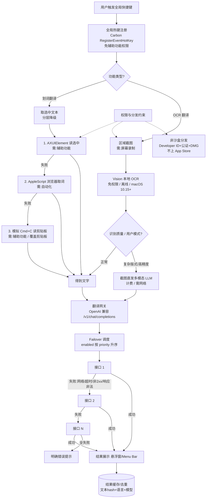

# macOS 翻译软件 — 阶段 1 可行性分析（门控）

| 项目 | 内容 |
|---|---|
| 文档阶段 | 阶段 1：技术与商业可行性评估（门控） |
| 目标平台 | macOS 桌面应用，单机个人使用 |
| 核心功能 | ① 快捷键划词翻译 ② 快捷键 OCR 翻译 ③ 用户自配多 LLM（OpenAI 兼容）按优先级 failover |
| 用户语言 | 简体中文 |
| 原始需求 | "想写个 mac 翻译软件…快捷键划词翻译、快捷键 ocr 翻译…自己配置 LLM 接口，openai 兼容格式，支持配置多个，按优先级调用，每次调用一个，失败才调用下一个…先分析可行性…" |
| 结论 | **GO（可行）** — 详见第 7 节 |

> 说明：本文只做可行性评估，不含 PRD、技术定稿、原型或代码。技术选型仅给倾向性判断，最终由架构师在技术文档阶段定稿。

---

## 1. 结论摘要（Executive Summary）

- **技术完全可行**：两大核心功能（划词、OCR）+ OpenAI 兼容多接口 failover 均为成熟工程模式，Bob、Easydict、沉浸式翻译等已验证同类路径（见第 5 节）。
- **关键约束不是技术，是权限与分发**：这类工具依赖辅助功能 / 屏幕录制 / 自动化权限，因此**不适合上 Mac App Store**（沙盒禁止全局热键与读取其他 App UI 树），应走 Developer ID 签名 + 公证 + DMG 分发。
- **技术栈倾向**：**原生 Swift + SwiftUI/AppKit**，而非 Web 技术栈——因需直接调用 AXUIElement、Vision、ScreenCaptureKit、Carbon HotKey 等系统原生 API。
- **隐私是设计红线**：选中文本与屏幕截图会发送至用户自配的第三方 LLM，必须做"用户知情"设计与数据最小化。
- **复杂度**：**中等（Medium）**，模块多但均有成熟方案，无算法创新，个人使用规模下工程风险可控。

---

## 2. 划词翻译技术路径分析

### 2.1 三条路径对比

| 路径 | 实现方式 | 所需权限 | 可靠性 | 对现有选中态破坏 | 适用 App 范围 | 备注 |
|---|---|---|---|---|---|---|
| **(a) 模拟 Cmd+C 读剪贴板** | 全局热键触发 → 发送 `Cmd+C` → 读 `NSPasteboard` | 辅助功能（发送按键）；快捷键本身用 Carbon 注册则免权限 | 中高 | **会覆盖用户剪贴板**；部分 App 复制时追加版权信息 | 几乎所有"可选中可复制"的文本 | Bob 的本质做法；无法复制的文本（图片/PDF 扫描件）失效 |
| **(b) AXUIElement 直接读选中文本** | 通过辅助功能 API 读取前台 App 的选中属性 | **辅助功能（必需）** | 中 | **不破坏剪贴板/选中态** | 仅限支持 AX 的 App；**Safari 不支持 AX 取词** | 体验最干净但覆盖率受限 |
| **(c) AppleScript / 浏览器 JS 取词** | 对浏览器发 Apple Event 取选中文本 | 自动化（Apple Events） | 中 | 不破坏剪贴板 | 仅浏览器（Safari/Chrome） | 需在浏览器开启"允许 Apple 事件中的 JavaScript" |

### 2.2 推荐方案：**分层降级链**（Easydict 验证）

```
Accessibility (AXUIElement) → AppleScript(浏览器) → 模拟 Cmd+C(兜底)
```

- **优先 (b)**：不破坏剪贴板、体验最好。
- AX 失败（未授权 / App 不支持，如 Safari）→ 浏览器走 (c)。
- 仍失败 → 降级 (a) Cmd+C 兜底，覆盖绝大多数场景。
- **必须提示用户**：兜底路径会覆盖剪贴板；无法复制的文本请改用 OCR 翻译。

> 竞品佐证：Easydict 采用"Accessibility > AppleScript > 模拟快捷键"三级链，并指出 Safari 不支持 AX 取词、浏览器需开启 Apple 事件 JS 选项。Bob 明确"划词本质是发 Cmd+C，文本不可复制则无法获取，建议用截图翻译"。

---

## 3. OCR 翻译技术路径分析

### 3.1 两条路径对比

| 路径 | 实现方式 | 所需权限 | 离线可用 | 准确率 | 成本 | 适用 |
|---|---|---|---|---|---|---|
| **(a) 截图 + Vision 本地识别 (`VNRecognizeTextRequest`)** | 区域截图 → 本地 OCR 出文字 → 文字交给 LLM 翻译 | **屏幕录制（截图必需）**；Vision 本身免权限 | ✅ 完全离线 | 中高（印刷体好，复杂排版/艺术字下降） | 零 OCR 成本 | 常规截图、文档、网页 |
| **(b) 截图直接交多模态 LLM** | 区域截图 → base64 图片直接发多模态模型"识别+翻译" | 屏幕录制 | ❌ 依赖网络/模型 | 高（尤其复杂版式、图文混排） | 按图 token 计费，成本较高 | 复杂排版、扫描件、需理解图文语义 |

### 3.2 Vision 能力要点（写实）

- **系统内置**：`VNRecognizeTextRequest` 自 **macOS 10.15 / iOS 13** 起内置；Bob 标注离线识别需 **macOS 11+**（不同 API revision 能力有差异）。Easydict 最新版要求 macOS 13+。
- **中英文支持**：需将 `zh-Hans`（简）/ `zh-Hant`（繁）置于 `recognitionLanguages` 首位；**英文是唯一可与中文配对的语言**。中文**不支持** language correction / customWords。
- **处理全在本地**：Vision 文本识别在设备端完成，隐私友好、无网络成本。
- **准确率权衡**：`accurate` 路径更准但慢，`fast` 约快 3 倍但可能漏小字；复杂排版 PDF 建议先栅格化或改用多模态。

### 3.3 推荐方案：**本地优先 + 多模态兜底（可组合）**

```
区域截图 → Vision 本地 OCR → 文字交 LLM 翻译（默认，零 OCR 成本、隐私好）
         → 若识别质量低 / 用户选择 → 截图直接交多模态 LLM（高精度兜底）
```

- 默认走 (a)：省钱、快、离线、隐私最优。
- 提供开关：用户在配置中可指定"OCR 模式 = 本地 / 多模态 / 本地失败后多模态"。
- **注意**：无论哪条路径，"区域截图"均需屏幕录制权限。

---

## 4. 多 LLM 接口按优先级 Failover 设计

### 4.1 配置模型

| 字段 | 说明 |
|---|---|
| name | 接口别名（用户可识别） |
| baseURL | OpenAI 兼容根地址（如 `https://api.xxx.com/v1`） |
| apiKey | 用户自备密钥 |
| model | 模型名 |
| priority | 优先级序号（小者先调用） |
| enabled | 启用开关 |
| timeout（可选） | 单次超时，默认建议 15–20s |

### 4.2 调用逻辑（每次只调一个，失败才降级）

1. 取所有 `enabled` 接口，按 `priority` 升序排列。
2. 依次尝试：**只调用当前一个**，成功即返回并停止。
3. 当前失败 → 降级到下一个；全部失败 → 向用户返回明确错误（最后一个错误原因 + 已尝试接口数）。

### 4.3 失败判定标准

- 网络错误：DNS 失败 / 连接拒绝 / SSL 错误。
- 超时：超过单次 timeout。
- HTTP 非 2xx：如 401（密钥错）、429（限流）、5xx（服务端）。
- 响应不合法：非 JSON、缺 `choices[0].message.content`、content 为空。

### 4.4 超时 / 重试边界

- **failover 即重试**：降级是"换下一个接口"，**不对同一接口反复重试**，避免延迟叠加与重复计费。
- 可选对 429/5xx 做**有限退避重试（如 1 次）**，但个人工具建议直接降级、把决定权交给用户配置。
- 链式尝试上限 = 启用接口数；建议 UI 展示"正在尝试第 N/M 个接口"。

### 4.5 避免重复翻译 / 缓存与去重（必要性）

| 机制 | 做法 | 必要性 |
|---|---|---|
| 请求 ID | 一次用户触发 = 一个 requestId，failover 链内共享同一次上下文 | 防止降级时重复发起 |
| 剪贴板变化检测 | 记录上次翻译内容 hash，选中态未变则不重复触发 | 防手抖/重复热键 |
| 结果缓存 | key = 文本 hash + 源/目标语言 + 模型；命中直接返回 | **省钱 + 提速 + 减少数据外发** |
| 去重 | 同一段文本短时间内多次请求合并 | 降低 API 成本 |

> 竞品佐证：沉浸式翻译支持"自定义接口地址 + API Key + 自定义模型"（OpenAI Chat 兼容 `.../v1/chat/completions`），并支持指向本地 Ollama（`http://localhost:11434/v1/chat/completions`），说明"用户自配 OpenAI 兼容接口"是成熟且被广泛采用的模式；链式 failover 是标准工程做法，可由本产品实现为差异化点。

---

## 5. 权限与合规风险（重点，写实）

### 5.1 权限清单

| 权限 | 触发功能 | 是否必需 | 说明 |
|---|---|---|---|
| **辅助功能 (Accessibility)** | AX 取词、模拟 Cmd+C、全局热键(CGEventTap 路径) | 划词翻译必需 | 系统设置 → 隐私与安全性 → 辅助功能。**Carbon 注册热键可免此权限** |
| **屏幕录制 (Screen Recording)** | 区域截图、OCR 翻译、读窗口标题 | OCR 必需 | 缺失时截图为黑屏；首次使用时申请 |
| **自动化 (Automation / Apple Events)** | 浏览器 AppleScript 取词、控制其他 App | 路径 (c) 需要 | 浏览器需开启"允许 Apple 事件中的 JavaScript" |

> 注意：更换签名 / 移动 App / 重新构建后，macOS 可能视为新应用而**要求重新授权**（Easydict 官方文档明确提及）。

### 5.2 沙盒与分发限制（关键决策）

- **Mac App Store 沙盒禁止**：全局热键（`CGEventTap`）、读取其他 App UI 树（`AXUIElement`）、系统级截屏。
- **结论**：本产品**不适合上架 Mac App Store**。应走 **Developer ID 签名 + 公证（notarization）+ Hardened Runtime + DMG 分发**，Gatekeeper 可正常打开。竞品 Bob、Easydict、CleanShot 等均采用此路线。
- 公证后需在干净机器用 `spctl -a -vv` 验证。

### 5.3 隐私与"用户知情"设计（红线）

- **风险**：选中的文本、屏幕截图会**发送给用户自配的第三方 LLM 服务**；截图可能含密码、私聊等敏感信息。
- **缓解设计**：
  - 首次配置接口时，明确提示"内容将发送至你配置的第三方服务，请自行评估其隐私政策"。
  - 默认本地 Vision OCR 优先，减少图像外发。
  - 提供"本地接口（如 Ollama `localhost`）"支持，满足零外发诉求。
  - 提供"敏感内容不缓存 / 一键清除历史与缓存"开关。
  - 权限按需申请（用时才请求），并用一行文案说明"授予后才能划词/截图"。
  - 不做遥测；如未来加入必须 opt-in 且绝不包含屏幕内容。

---

## 6. 技术路径与权限依赖关系图



---

## 7. 复杂度与工作量粗评

| 维度 | 评估 |
|---|---|
| 模块数量 | 6–8 个：全局热键、划词取词链、区域截图、Vision OCR、LLM 客户端 + failover、配置 UI、结果展示 UI、权限引导/缓存 |
| 原生能力 | 高：AXUIElement、ScreenCaptureKit、Vision、Carbon HotKey、TCC 权限、签名公证 |
| UI 形态 | Menu Bar 常驻 + 悬浮结果窗 + 设置面板（轻量，非复杂业务系统） |
| 算法创新 | 无，均为成熟 API 与工程模式 |
| **综合复杂度** | **中等（Medium）**——比常规 CRUD 应用复杂（系统级集成 + 权限），但模块边界清晰、方案成熟，个人使用场景下风险可控 |

---

## 8. 竞品参照（可行性佐证与来源）

| 竞品 | 关键实现 / 权限 | 对本项目的启示 | 来源 |
|---|---|---|---|
| **Bob** | 划词本质 = Cmd+C；需辅助功能 + 屏幕录制（10.15+）；离线 OCR（11+）；30+ 服务、多开、插件系统 | 验证 Cmd+C 路径与权限模型；离线 OCR 可行 | bobtranslate.com/guide ; github.com/geekhuyang/Bob |
| **Easydict** | 三级取词链 Accessibility > AppleScript > Cmd+C；Safari 不支持 AX；Apple Vision OCR；需辅助功能/屏幕录制/自动化；GPL-3.0，macOS 13+ | **取词降级链与多模态/系统 OCR 组合的直接范本** | github.com/Liujianlin0/Easydict ; blog.gitcode.com/2123d92e8cb32507cb78b9a3ce7fd4dc.html |
| **沉浸式翻译** | 自定义 OpenAI 兼容接口 `.../v1/chat/completions` + 自定义模型，支持本地 Ollama `localhost:11434` | 验证"用户自配 OpenAI 兼容接口"成熟可行 | immersivetranslate.com/zh-Hans/docs/services/ai/ ; ofox.ai/docs/integrations/immersive-translate |
| **Apple Vision 文档** | `VNRecognizeTextRequest` 支持中英文、离线、设备端处理；中文需置首位，英文是唯一可配对语言 | OCR 路径官方依据与能力边界 | developer.apple.com/documentation/vision/recognizing-text-in-images |
| **macOS 权限/分发实践** | MAS 沙盒禁全局热键(CGEventTap)与 AXUIElement；同类工具走 Developer ID + 公证 + DMG；权限变更后需重授 | 分发路径与权限设计依据 | pinvari.com/blog/menu-bar-apps-for-mac ; github.com/daveebbelaar/bama (os-integrations) ; github.com/Hinsane5/XPlain (security.md) |

---

## 9. 明确结论

### GO ✅ — 项目可行，建议进入阶段 2（PRD 需求文档 + 产品原型）

**核心理由：**
1. 两大核心功能均有成熟、被头部竞品验证的技术路径，无技术不确定性。
2. 用户自配 OpenAI 兼容多接口已是业界成熟模式，链式 failover 为标准工程做法，可实现为差异化点。
3. 权限与分发路径清晰：放弃 App Store，走 Developer ID 签名 + 公证 + DMG，风险可控。
4. 单机个人使用、无后端与账号体系，商业/运维成本低。
5. 复杂度中等，模块边界清晰，无算法创新，工程风险可控。

### 进入 PRD 前需向用户澄清的问题清单

| # | 问题 | 影响 |
|---|---|---|
| 1 | 应用形态：**Menu Bar 常驻**（无 Dock 图标）还是标准 Dock App？ | 决定 UI 骨架与权限引导方式 |
| 2 | 翻译结果**如何展示**：悬浮窗 / 通知 / 自动复制到剪贴板 / 替换选中文本？ | 决定结果交互与是否需"写剪贴板/替换"权限 |
| 3 | 是否需要**翻译历史 & 收藏**？ | 影响数据模型与缓存设计 |
| 4 | **目标语言默认值**（简体中文？）与是否需要源语言自动检测？ | 影响 prompt 模板 |
| 5 | **默认快捷键组合**（划词 / OCR），与现有软件是否冲突？ | 决定热键默认值与冲突处理 |
| 6 | OCR 默认模式：**本地 Vision 优先** 还是 **多模态优先**？ | 影响成本与精度默认策略 |
| 7 | LLM 接口的**超时时长、是否对同一接口重试**、缓存开关默认值？ | 影响 failover 与缓存策略 |
| 8 | 最低支持的 **macOS 版本**（影响可用 API 与 OCR 能力）？ | 影响兼容性范围 |
| 9 | 是否需要**本地离线接口**（如 Ollama）作为零外发选项？ | 影响隐私设计与配置复杂度 |

> 待用户确认以上问题后，再进入阶段 2：PRD 需求文档 + 产品原型（本阶段不编程）。
