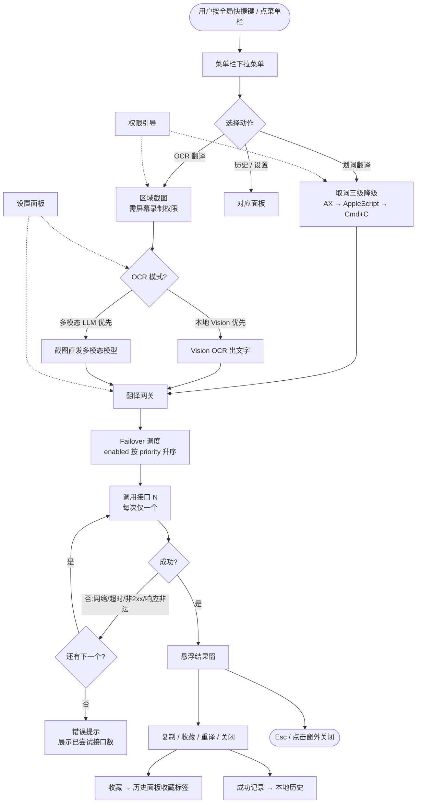
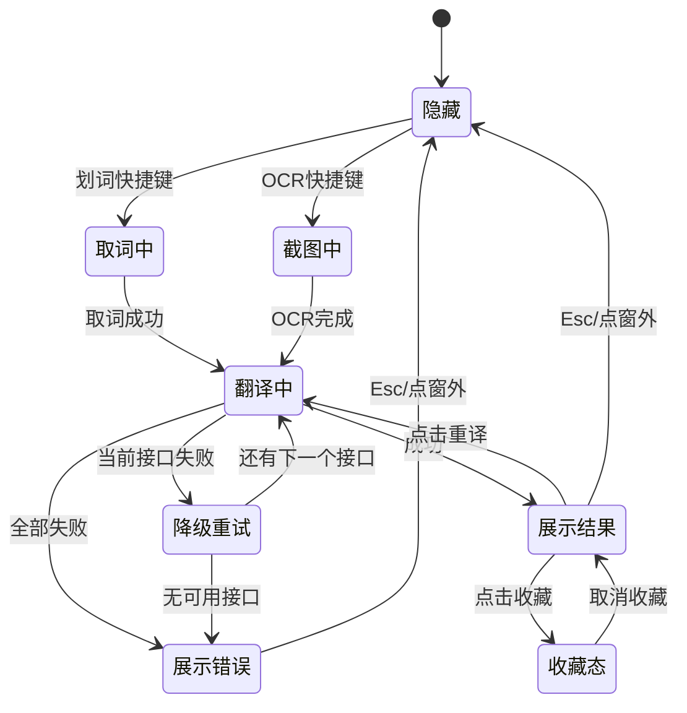

# macOS 翻译软件 — 产品需求文档（PRD）

## 0. 项目信息

| 项目 | 内容 |
|---|---|
| Language | 简体中文 |
| Programming Language | 倾向原生 **Swift + SwiftUI/AppKit**（需 AXUIElement / Vision / ScreenCaptureKit / Carbon HotKey；最终由架构师在技术文档定稿） |
| Project Name | `mac_translator` |
| 阶段 | 阶段 2：PRD 需求文档 + 产品原型（依据阶段 1 GO 结论） |
| 目标平台 | macOS 桌面应用，单机个人使用，无后端 / 无账号体系 |
| 原始需求复述 | 用户希望开发一款 macOS 翻译软件：① 快捷键划词翻译；② 快捷键 OCR 翻译；可自行配置多个 OpenAI 兼容格式的 LLM 接口，按优先级调用，**每次只调一个，失败才调用下一个**。文档确认后再编程。 |

### 0.1 用户已确认的 4 项硬约束（不可变更）

| # | 决策项 | 用户确认结果 | 对设计的约束 |
|---|---|---|---|
| 1 | 应用形态 | **菜单栏常驻**：Menu Bar 图标 + 快捷键唤起悬浮窗 | 不做 Dock 主窗口形态（无主文档窗口）；菜单栏下拉菜单是主要功能入口 |
| 2 | 结果展示 | **仅悬浮结果窗** | 默认行为不含自动复制剪贴板、系统通知、替换选中文本；此类仅作 P2 备选 |
| 3 | 历史收藏 | **要历史 + 收藏**（本地持久化） | 需 History / Favorite 模块与本地存储 |
| 4 | OCR 策略 | **用户可切换** | 设置提供开关，默认本地 Vision 优先，可切到多模态 LLM 优先 |

> 其余 5 项用户未回答，已在第 4 章采用合理默认值并列出，不阻塞后续阶段。

---

## 1. 产品定义

### 1.1 产品目标（Product Goals）

1. **零切换翻译**：用户在任何 App 中选中文本或看到屏幕文字，通过一个快捷键即可获得翻译，全程不离开当前工作流。
2. **接口可控可降级**：用户完全掌控 LLM 接口（自备 key、多个优先级、失败自动降级），兼顾成本、精度与可用性，且明确知道本次翻译用了哪个接口。
3. **隐私知情与本地沉淀**：翻译内容与截图的去向对用户透明；翻译历史与收藏仅本地持久化，可随时清除。

### 1.2 用户故事（User Stories）

1. 作为**阅读外文资料的用户**，我希望选中一段文字按快捷键就弹出译文，这样我不用复制到网页再粘贴。
2. 作为**遇到图片/PDF 扫描件文字的用户**，我希望按快捷键框选屏幕区域就得到译文，这样不可复制的内容也能翻译。
3. 作为**有多个 LLM 账号的用户**，我希望按优先级配置接口，主接口失败时自动切下一个，这样翻译不会因为单个服务故障而中断。
4. 作为**需要回头查证的用户**，我希望历史与收藏保存在本地，这样我能快速找回并复用之前的译文。
5. 作为**关注隐私的用户**，我希望在设置里看到权限状态、切换本地 OCR、并一键清除缓存与历史，这样我能控制敏感内容的去向。

---

## 2. 需求池（Requirements Pool）

> 优先级：**P0 Must have**（首版必须） / **P1 Should have**（重要，可次迭代） / **P2 Nice to have**（备选增强）。每条均给出可验收标准。

### 2.1 P0 — Must have（10 条）

| ID | 需求 | 验收标准 |
|---|---|---|
| P0-01 | **菜单栏常驻与全局快捷键** | 启动后仅显示 Menu Bar 图标（无 Dock 主窗口）；下拉菜单含「划词翻译 / OCR 翻译 / 历史 / 设置 / 退出」五项；支持两个全局快捷键唤起（默认值见 §4），在任意前台 App 可触发；热键被占用时设置页给出冲突提示。 |
| P0-02 | **划词翻译取词链路** | 触发后按 `AXUIElement → AppleScript(浏览器) → 模拟 Cmd+C` 顺序降级取词；任一级失败自动进入下一级；取词结果非空才发起翻译；走 Cmd+C 兜底时结果窗提示「已覆盖剪贴板」；全部失败时提示「无法获取选中文本，请尝试 OCR 翻译」；取词为空不产生 LLM 请求。 |
| P0-03 | **OCR 翻译链路与模式切换** | 触发后进入区域截图；按设置中的 OCR 模式执行：本地模式用 `VNRecognizeTextRequest` 识别文字（`zh-Hans`/`en-US`）再交 LLM 翻译，多模态模式将截图直发支持视觉的模型；取消截图不产生请求；识别结果为空提示重新框选；模式切换在设置中即时生效并持久化。 |
| P0-04 | **悬浮结果窗（唯一默认结果形态）** | 翻译完成后以非激活悬浮窗展示：原文、译文、复制/收藏/重译按钮、当前实际使用的 LLM 接口标签（名称 + 模型）、耗时、降级说明；窗口不抢走前台 App 焦点；Esc 或点击窗外可关闭；默认不做自动复制/系统通知/替换选中文本。 |
| P0-05 | **LLM 多接口配置管理** | 设置页支持新增/编辑/删除接口；字段含 `名称 / baseURL / apiKey / model / 启用开关 / 优先级`；apiKey 遮罩显示；baseURL 给出 OpenAI 兼容格式（`/v1/chat/completions`）提示；至少可配置 2 个接口；无任何启用接口时禁用翻译并提示先配置。 |
| P0-06 | **按优先级 Failover 调用** | 每次请求**只调用一个**接口：取所有启用接口按优先级升序的首个；成功即停止；失败判定覆盖网络错误/超时/HTTP 非 2xx/响应不合法（非 JSON 或缺 `choices[0].message.content`）；失败自动降级下一个，全部失败返回明确错误与已尝试接口数；结果窗标签显示实际成功的接口，若发生降级标注「由接口 X 降级而来」。 |
| P0-07 | **历史记录本地持久化** | 每次成功翻译（划词/OCR）落一条记录，含时间、原文、译文、来源类型、使用接口；本地存储，重启后保留；历史列表按时间倒序；100 条内滚动流畅；支持删除单条与清空全部。 |
| P0-08 | **收藏功能** | 结果窗收藏按钮可切换收藏态（空心/实心星视觉变化）；收藏项出现在历史面板「收藏」标签；取消收藏仅从收藏列表移除、不删除历史；收藏状态本地持久化。 |
| P0-09 | **设置面板** | 单一设置面板含「通用 / LLM 接口 / OCR / 权限 / 快捷键」分区；修改即时保存无需重启；提供「测试接口」按钮对指定接口发最小请求并显示连通结果；可查看 failover 顺序说明与 OCR 模式切换（默认本地 Vision 优先）。 |
| P0-10 | **权限引导** | 首次使用划词/OCR 时按需分别请求辅助功能、屏幕录制、自动化权限，并附一行用途说明；权限状态在设置面板集中展示（已授权/未授权）且支持一键跳转系统设置对应窗格；未授权时相关功能禁用并提示；权限被撤销后可重新检测。 |

### 2.2 P1 — Should have（6 条）

| ID | 需求 | 验收标准 |
|---|---|---|
| P1-01 | 结果缓存与去重 | 以「文本 hash + 源/目标语言 + 模型」为 key 缓存结果；相同请求命中缓存直接返回；提供缓存开关与清除入口；缓存命中在结果窗标注。 |
| P1-02 | 翻译中与降级进度反馈 | 翻译中显示「正在尝试第 N/M 个接口」；降级时状态文本更新；超时按 §4 默认值生效。 |
| P1-03 | 历史搜索与筛选 | 支持按原文/译文关键字搜索，按来源类型（划词/OCR）与收藏状态筛选。 |
| P1-04 | 目标语言与源语言设置 | 目标语言默认简体中文可改；源语言支持自动检测与手动指定；设置随请求带入 prompt。 |
| P1-05 | 快捷键自定义与冲突检测 | 用户可自定义划词/OCR 快捷键；与系统或其他 App 常见组合冲突时给出提示。 |
| P1-06 | 权限状态动态刷新 | 权限缺失时以 1–2s 间隔轮询检测，授权后立即解锁对应功能；设置页打开时刷新状态。 |

### 2.3 P2 — Nice to have（4 条，备选，非默认行为）

| ID | 需求 | 验收标准 |
|---|---|---|
| P2-01 | 结果输出增强（用户未选，仅备选） | 以**用户可选开关**提供自动复制结果 / 系统通知 / 替换选中文本；三者默认关闭，不得作为默认行为。 |
| P2-02 | TTS 朗读 | 结果窗提供朗读按钮，朗读原文与译文，可关闭。 |
| P2-03 | 多接口结果对照 | 开启后同一文本并发调用多个接口，结果窗以标签页对照展示（与「每次只调一个」的 failover 默认模式互斥，需明确提示）。 |
| P2-04 | 历史导出 | 支持将历史/收藏导出为 JSON 或 Markdown 文件。 |

---

## 3. UI 设计稿（UI Design Draft）

### 3.1 页面与状态流程图

### 3.2 悬浮结果窗状态图

### 3.3 界面清单与布局要点

| 界面 | 布局与元素 |
|---|---|
| ① 菜单栏下拉菜单 | 顶部 Menu Bar 图标；下拉项：划词翻译（显示默认快捷键）、OCR 翻译（显示默认快捷键）、分隔线、历史、设置、退出。权限未授权项灰显并带小警示图标。 |
| ② 悬浮结果窗 | 顶部：来源徽标 + 耗时 + 实际使用 LLM 接口标签（含降级说明）；中部：原文区（可折叠）、译文区（主视觉）；底部：复制 / 收藏（星形切换）/ 重译；非激活面板样式、圆角、阴影，不抢焦点。 |
| ③ 设置 — LLM 接口 | 顶部说明「按优先级从上到下依次调用，每次仅一个，失败才降级」；接口卡片列表（可拖拽/上下移排序）：名称、baseURL、apiKey（遮罩）、model、启用开关、优先级序号、删除、「测试接口」；底部「添加接口」。 |
| ④ 设置 — OCR | 分段控件「本地 Vision 优先 ↔ 多模态 LLM 优先」；两模式说明（离线/成本 vs 精度/成本）；识别语言选择；屏幕录制权限状态提示。 |
| ⑤ 历史与收藏 | 标签页「全部 / 收藏」；搜索框；列表项显示时间、来源徽标、原文摘要、译文、使用接口、收藏星标；支持删除单条与清空。 |
| ⑥ 设置 — 权限/通用/快捷键 | 权限三行状态卡（辅助功能/屏幕录制/自动化）+ 跳转系统设置按钮；通用含目标语言、缓存开关、清除数据；快捷键含两项自定义。 |

> 交互原型见同目录 `03-产品原型.html`（单文件自包含，浏览器直接打开）。

---

## 4. 待确认问题（用户未回答，采用建议默认值，不阻塞）

| # | 问题 | **建议默认值** | 影响与备注 |
|---|---|---|---|
| 1 | 目标语言默认值 / 源语言自动检测 | 目标语言**简体中文**；源语言**自动检测**（可手动指定） | 符合用户主要语言；写入 prompt 模板 |
| 2 | 划词 / OCR 默认快捷键 | 划词 `⌥D`（Option+D）；OCR `⌥⇧S`（Option+Shift+S） | 与 Bob/Easydict 一致，用户习惯成本低；可自定义（P1-05） |
| 3 | LLM 超时、重试与缓存 | 单次超时 **20s**；**不对同一接口重试**，直接降级下一个；结果缓存**默认开启**、可关闭可清除 | 控制延迟与重复计费；缓存省成本并减少数据外发 |
| 4 | 最低 macOS 版本 | **macOS 13.0+** | 与 Easydict 最新版一致；Vision 离线 OCR 在 11+ 可用，13+ 为稳妥基线 |
| 5 | 是否支持 Ollama 本地接口 | **支持**（baseURL 填 `http://localhost:11434/v1`，model 填本地模型名，apiKey 任意） | 满足零外发隐私诉求；不增加额外配置项，兼容 OpenAI 格式即可 |

> 以上默认值将在架构师技术文档阶段固化；如用户后续有不同选择，按变更流程调整。

---

## 5. 范围边界（Non-Goals）

- 首版**不做** Dock 主窗口形态、不做系统通知/自动复制/替换选中文本（P2 备选除外）。
- 首版**不做**网页全文双语对照（那是浏览器插件形态，如沉浸式翻译）。
- 首版**不做**多端同步与账号体系（纯单机本地）。
- 首版**不做** Mac App Store 上架（沙盒限制，见阶段 1 分析）；分发为 Developer ID 签名 + 公证 + DMG。
