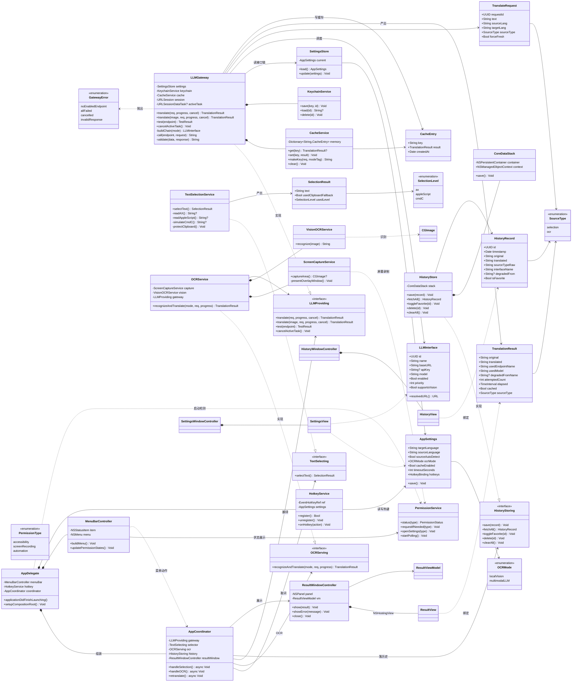
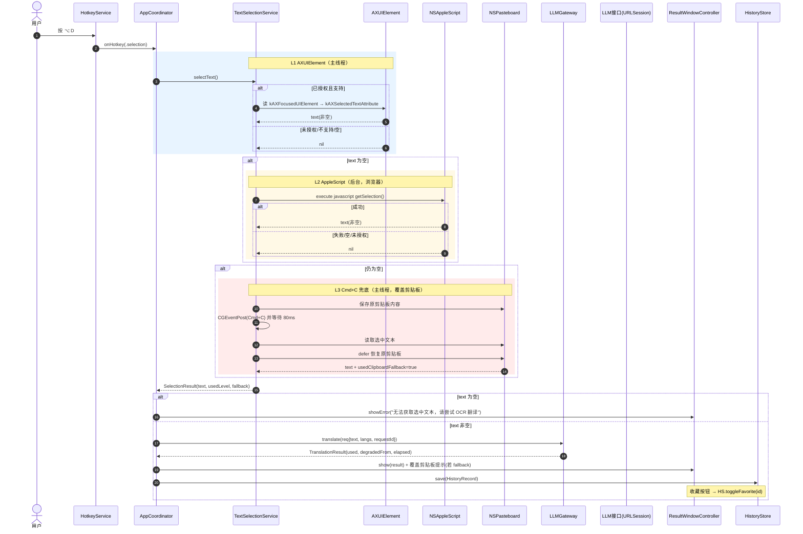
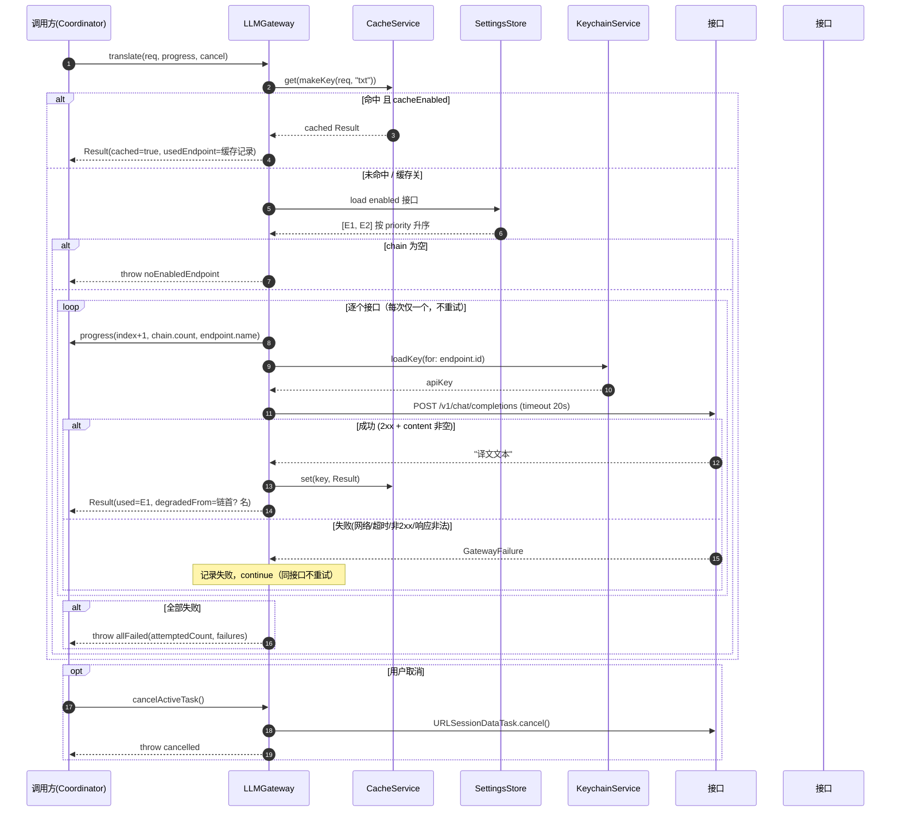
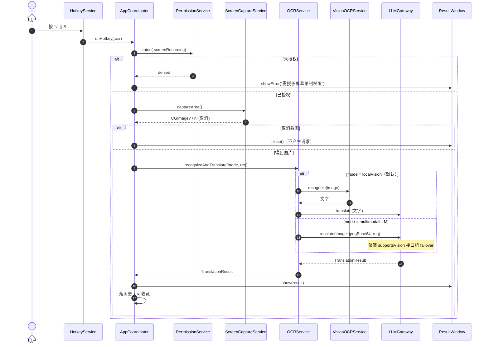
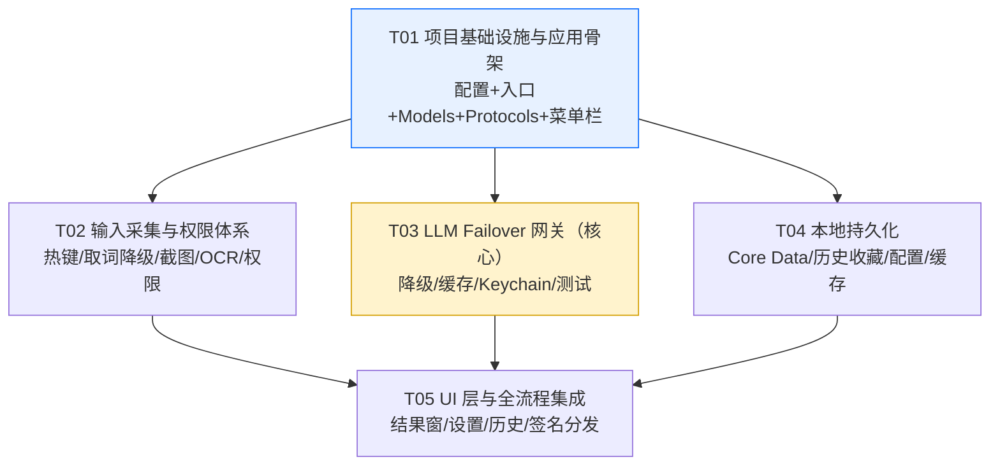

# macOS 翻译软件《划译》— 阶段 3 技术文档（架构设计 + 任务分解）

| 文档项 | 内容 |
|---|---|
| 阶段 | 阶段 3：技术文档（架构设计 + 任务分解） |
| 项目名 | `mac_translator`（产品名「划译」） |
| 目标平台 | macOS 13.0+（Ventura 及以上），单机个人使用，无后端 / 无账号 |
| 上游基线 | `01-可行性分析.md`（GO 结论）、`02-PRD.md`（10 条 P0）、`03-产品原型.html`（界面参考） |
| 语言 / 框架 | Swift 5.9 + SwiftUI（视图）+ AppKit（系统骨架） |
| 分发 | 非沙盒，Developer ID 签名 + 公证 + Hardened Runtime + DMG（不上 Mac App Store） |
| 本文作用 | 工程师实现的唯一技术基线；含框架选型、文件清单、类图/时序图、可执行任务列表 |

> **设计基线声明**：本文严格固化 PRD 第 4 章 5 项默认值与用户 4 项硬约束，不再二次讨论；任何变更走变更流程。

| 类别 | 已固化内容 |
|---|---|
| 4 项硬约束 | ① 菜单栏常驻（Menu Bar 图标 + 快捷键唤起悬浮窗，无 Dock 主窗口）；② 结果仅悬浮结果窗（自动复制/通知/替换为 P2 且默认关）；③ 历史 + 收藏本地持久化；④ OCR 用户可切换（默认本地 Vision 优先，可切多模态 LLM） |
| 5 项默认值 | ① 目标语言简体中文 / 源语言自动检测；② 划词 `⌥D`、OCR `⌥⇧S`；③ 超时 20s、同一接口不重试直接降级、缓存默认开；④ 最低 macOS 13.0+；⑤ 支持 Ollama（`http://localhost:11434/v1`） |

---

## 1. 实现方案与框架选型

### 1.1 技术栈定稿

| 维度 | 定稿 | 说明 |
|---|---|---|
| 语言 | Swift 5.9+ | 原生系统 API 一等公民；async/await 简化降级链与网络 |
| 最低系统 | macOS 13.0+ | PRD 固化；`ScreenCaptureKit` 自 13.0 可用，Vision 离线 OCR 11+ |
| UI 框架 | **SwiftUI + AppKit 混合** | SwiftUI 写内容视图，AppKit 写系统级窗口/菜单栏（边界见 §1.3） |
| 工程/依赖管理 | Xcode 工程（SwiftPM 集成） | 无第三方运行时依赖，全部使用系统框架 |
| 架构模式 | **MVVM + Service 层 + 依赖注入（Composition Root）** | `AppDelegate` 作为组装根，Service 协议化便于单测 |
| 网络 | `URLSession` async/await | 原生、支持超时与取消，无 Alamofire |
| OCR | `Vision.VNRecognizeTextRequest` + 多模态 LLM | 双模式，见 §2.2 |
| 取词 | AXUIElement / NSAppleScript / CGEvent 三级降级 | 见 §2.1 |
| 全局热键 | Carbon `RegisterEventHotKey` | 免辅助功能权限注册，见 §2.6 |
| 持久化 | Core Data（历史/收藏）+ JSON Codable（配置）+ Keychain（apiKey）+ JSON（缓存） | 见 §2.4 |
| 构建分发 | xcodebuild archive → Developer ID 签名 → 公证 → DMG | 见 §2.7 |

### 1.2 为什么不用 Electron / Tauri（关键技术论证）

| 系统能力 | 原生 Swift 方案 | Electron / Tauri 的代价 |
|---|---|---|
| **AXUIElement 取词** | 直接 `AXUIElementCreateApplication` 等 C API | 需自研 Node 原生插件 / Tauri Rust 插件桥接 Objective-C，权限与生命周期管理复杂 |
| **Vision OCR** | `VNRecognizeTextRequest` 原生调用 | 必须外挂 Swift 辅助进程 + IPC，增加崩溃面与打包复杂度 |
| **区域截图** | `ScreenCaptureKit` / `CGWindowListCreateImage` + 无边框覆盖窗 | Web `getDisplayMedia` 只能捕获应用内，无法做系统级任意区域截图 |
| **全局热键** | Carbon `RegisterEventHotKey`（注册免权限） | Electron 全局热键需辅助功能权限；Tauri 需插件，且前台焦点切换行为不一致 |
| **非激活悬浮窗** | `NSPanel` `.nonactivatingPanel` + `.floating`，不抢焦点 | `BrowserWindow` 难以做到「显示但不夺取前台焦点」，易打断用户工作流（违反 P0-04） |
| **Menubar 常驻 + accessory 模式** | `NSStatusItem` + `LSUIElement`，无 Dock | Electron tray 可近似，但常驻内存数百 MB；原生常驻仅数十 MB |
| **签名/公证/沙盒策略** | Developer ID + Hardened Runtime，控制权完全在手 | 打包体积大、公证链路冗长、entitlements 对齐困难 |

**结论**：本产品的核心价值全部建立在系统级原生能力之上，Web 技术栈仅为 UI 层带来便利却需为每一项系统能力写原生桥接，得不偿失；且「悬浮窗不抢焦点」这一硬需求在 Web 栈中难以正确实现。故定稿原生 Swift。

### 1.3 SwiftUI 与 AppKit 边界（职责切分）

| 层 | 框架 | 负责 | 具体 API |
|---|---|---|---|
| 菜单栏与下拉 | **AppKit** | 常驻图标与菜单 | `NSStatusBar.system.statusItem`，`NSMenu`/`NSMenuItem`（划词/OCR/历史/设置/退出） |
| 悬浮结果窗 | **AppKit 容器 + SwiftUI 内容** | 非激活浮动面板 | `NSPanel`（`styleMask: [.nonactivatingPanel, .fullSizeContentView]`、`level: .floating`、`canBecomeKey = false`），内部 `NSHostingView<ResultView>` |
| 设置 / 历史窗 | **AppKit 容器 + SwiftUI 内容** | 可激活普通窗口 | `NSWindowController` + `NSHostingView<SettingsView/HistoryView>` |
| 区域截图覆盖层 | **AppKit** | 全屏无边框框选 | `NSWindow`（`styleMask: .borderless`、`level: .screenSaver`）+ 拖拽框选视图 |
| 内容视图 | **SwiftUI** | 所有界面元素 | `ResultView`、`SettingsView`（5 pane）、`HistoryView`、复用组件；通过 `@Observable`/`ObservableObject` 绑定 ViewModel |
| 应用生命周期 | **AppKit** | accessory 模式、组装根 | `NSApplicationDelegate`、`setActivationPolicy(.accessory)` |

> 原则：**系统级窗口/权限/事件归 AppKit，业务 UI 归 SwiftUI**，二者通过 `NSHostingView` 桥接，状态通过 ViewModel 单向流动。

### 1.4 架构分层

```
┌─────────────────────────────────────────────────────────┐
│  UI 层 (SwiftUI + AppKit 容器)                            │
│  MenuBarController / ResultView / SettingsView / HistoryView│
├─────────────────────────────────────────────────────────┤
│  ViewModel 层 (@Observable)                              │
│  ResultVM / SettingsVM / HistoryVM                       │
├─────────────────────────────────────────────────────────┤
│  Service 层 (协议化，可注入)                              │
│  Hotkey / TextSelection / OCR / LLMGateway / Cache /     │
│  Permission / HistoryStore / Keychain / Persistence      │
├─────────────────────────────────────────────────────────┤
│  Model 层 (Codable / NSManagedObject)                    │
│  AppSettings / LLMInterface / TranslateRequest/Result ... │
└─────────────────────────────────────────────────────────┘
```

- `AppDelegate` = Composition Root：初始化并注入所有 Service，注册热键，构建菜单栏。
- `AppCoordinator`：编排「取词/OCR → 网关 → 结果窗 → 落历史」的完整流程，UI 只调用 Coordinator。
- 所有跨模块协作通过 protocol（`LLMProviding`、`TextSelecting`、`OCRServing` 等），便于单测 mock。

### 1.5 关键挑战解决方案索引

| # | 挑战 | 方案章节 |
|---|---|---|
| 1 | 技术栈定稿 / SwiftUI-AppKit 边界 | §1.1 / §1.2 / §1.3 |
| 2 | 划词三级降级链 | §2.1 |
| 3 | OCR 双模式 | §2.2 |
| 4 | LLM Failover 网关（核心） | §2.3 |
| 5 | 本地持久化 | §2.4 |
| 6 | 权限管理 | §2.5 |
| 7 | 全局快捷键 | §2.6 |
| 8 | 文件结构与构建分发 | §2.7 / §3 / §7 |
| 9 | 任务列表 | §6 |

---

## 2. 关键技术方案

### 2.1 划词取词三级降级链

**降级顺序**：`AXUIElement → AppleScript(浏览器) → 模拟 Cmd+C`（沿用可行性分析 + Easydict 验证路径）。

| 级别 | 具体 API / 调用方式 | 成功判定 | 失败判定 | 权限要求 | 线程 | 剪贴板影响 |
|---|---|---|---|---|---|---|
| L1 AXUIElement | `AXUIElementCreateApplication(pid)` → `AXUIElementCopyAttributeValue(..., kAXFocusedUIElementAttribute)` → 对焦点元素取 `kAXSelectedTextAttribute`，转 `String` | 返回非空字符串 | `AXIsProcessTrusted()==false` / 属性返回 `nil` / 值为空 / App 不支持 AX（如 Safari） | 辅助功能 | **主线程**（AX API 非线程安全，需与主 RunLoop 同步） | 无 |
| L2 AppleScript | `NSAppleScript(source: "tell application \"Google Chrome\" to execute javascript \"window.getSelection().toString()\"")`；Safari 用 `do JavaScript`；`executeAndReturnError(&error)` | 返回非空字符串 | 脚本执行抛错（如错误码 `-1743` 自动化未授权）、返回 `NSNull`、空串；非浏览器前台则跳过 | 自动化 + 浏览器开启「允许 Apple 事件中的 JavaScript」 | 后台队列（可能阻塞） | 无 |
| L3 模拟 Cmd+C | `CGEvent(keyboardEventSource: nil, virtualKey: 8 /* c */, keyDown: true)`，`flags = .maskCommand`；`CGEventPost(.cghidEventTap, down)` + `keyUp`；随后读 `NSPasteboard.general.string(forType: .string)` | 剪贴板读到非空文本 | 读不到 / 空串 | 辅助功能（发送按键事件） | **主线程**（事件投递需活跃 RunLoop；投递后阻塞约 80ms 等待目标 App 处理） | **会覆盖**（须保护，见下） |

**剪贴板保护（仅 L3）**：

```
1. 读 NSPasteboard.general.changeCount 与全部 pasteboardItems（逐 item 保存 type→Data 字典）
2. 发送 Cmd+C，等待 ~80ms
3. 读取选中文本作为本次原文
4. 恢复：pasteboard.clearContents() → 用保存的 Data 重建 NSPasteboardItem → writeObjects
5. 无论成功失败都在 defer 中恢复；返回 SelectionResult.usedClipboardFallback = true 供结果窗提示「已覆盖剪贴板」（PRD P0-02）
```

**降级控制与边界**：

- 任一级成功（非空）立即返回，不再尝试下一级。
- 取词结果为空 → **不发起任何 LLM 请求**，结果窗提示「无法获取选中文本，请尝试 OCR 翻译」。
- L1 未授权时不调用直接跳 L2；L2 自动化未授权时跳 L3。
- `SelectionResult { text: String, usedClipboardFallback: Bool, usedLevel: SelectionLevel }`。
- 去重（P1-01 辅助）：记录上次取词 hash + 时间窗（1s），相同则不重复翻译，防手抖。

### 2.2 OCR 双模式

**区域截图（两模式共用前置）**：

1. 创建 `NSWindow`（`.borderless`，`level = .screenSaver`，覆盖全屏，半透明遮罩 + 可拖拽选择框视图）。
2. 用户拖拽得到 `CGRect` → `CGWindowListCreateImage(rect, .optionOnScreenOnly, kCGNullWindowID, .bestResolution)` 得到 `CGImage`（需屏幕录制权限）；取消则直接返回，不产生请求。
3. 截图后按 `AppSettings.ocrMode` 分流。

| 模式 | 处理链路 | 请求形态 | 适用 |
|---|---|---|---|
| `.localVision`（默认） | `VNRecognizeTextRequest`：`recognitionLevel = .accurate`；`recognitionLanguages = ["zh-Hans", "en-US"]`（中文置首位，英文唯一可配对）；`usesLanguageCorrection = false`（中文不支持）；取 `topCandidates(1)` 逐行拼接 → 文本交 LLM 翻译 | 普通文本 `/chat/completions` | 常规截图、文档、网页；离线、零 OCR 成本 |
| `.multimodalLLM` | `CGImage` 缩放（最长边 ≤ 2048）→ `NSBitmapImageRep` → JPEG（compression 0.8）→ base64 → 构造多模态请求，模型须支持视觉 | 多模态 `/chat/completions` | 复杂版式、扫描件、图文混排；按图计费、需联网 |

**多模态请求体构造（OpenAI 兼容）**：

```json
{
  "model": "gpt-4o",
  "messages": [
    {"role": "system", "content": "你是 OCR 与翻译助手。识别图片中的文字并翻译为简体中文，仅输出译文。"},
    {"role": "user", "content": [
      {"type": "text", "text": "请识别并翻译图中文字"},
      {"type": "image_url", "image_url": {"url": "data:image/jpeg;base64,/9j/4AAQ...", "detail": "auto"}}
    ]}
  ],
  "temperature": 0
}
```

**模式切换持久化**：`.ocrMode` 存入 `AppSettings`（JSON），设置页分段控件切换即时写入，下次启动保持（PRD P0-03/P0-09）。**前置屏幕录制权限**：无权限时截图为黑屏，OCR 功能禁用并提示（§2.5）。

### 2.3 LLM Failover 网关（核心）

#### 2.3.1 接口配置模型

| 字段 | 类型 | 说明 |
|---|---|---|
| `id` | `UUID` | 唯一标识，Keychain 账户键 |
| `name` | `String` | 用户可识别别名 |
| `baseURL` | `String` | OpenAI 兼容根地址，如 `https://api.xxx.com/v1` 或 `http://localhost:11434/v1` |
| `apiKey` | `String?` | **不明文落盘**，运行时从 Keychain 读取；Ollama 可填任意值 |
| `model` | `String` | 模型名 |
| `enabled` | `Bool` | 启用开关 |
| `priority` | `Int` | 升序调用（小者先），UI 拖拽/上下移重排后重编号 |
| `supportsVision` | `Bool` | 多模态 OCR 是否需要（可按 model 推断或用户勾选，用于过滤多模态链） |

#### 2.3.2 调用流程

```
1. 读取全部 enabled 接口，按 (priority asc, id asc) 稳定排序 → chain
2. chain 为空 → 禁用翻译并提示「请先配置并启用至少一个接口」（P0-05）
3. for (index, endpoint) in chain.enumerated():
     a. 回调 onProgress(index+1, chain.count, endpoint.name) →「正在尝试第 N/M 个接口」
     b. 读取 apiKey（Keychain），规范化 URL（见下），构造 URLRequest
     c. URLSession.data(for:) await；timeoutIntervalForRequest = 20s；保存 task 以支持 cancel()
     d. 校验响应 → 成功即 return，停止后续
     e. 失败 → 记录 GatewayFailure，继续下一个
4. 全部失败 → throw GatewayError.allFailed(attemptedCount: chain.count, lastError, failures)
```

- **每次只调一个**：串行 `for` 循环，无并发、无对同一接口的二次重试（PRD §4 固化）。
- **URL 规范化**：去首尾空白、去尾部 `/`，若已含 `/chat/completions` 则直接用，否则拼接 `/chat/completions`。
- **请求 ID**：一次触发生成 `requestId: UUID`，整条 failover 链共享；去重/日志用，**不进入缓存 key**。
- **取消**：`LLMGateway.activeTask` 保存当前 `URLSessionDataTask`，`cancel()` 时置位 `isCancelled`，循环内检测后立即中止，不继续降级。

#### 2.3.3 失败判定标准

| 类别 | 判定 | 捕获方式 |
|---|---|---|
| 网络错误 | DNS 失败 / 连接拒绝 / SSL 错误 | `URLError` 非超时分支 |
| 超时 | 超过 20s | `URLError.code == .timedOut`（-1001）/ `timeoutIntervalForRequest` |
| HTTP 非 2xx | 401/429/5xx 等 | `guard (200..<300).contains(http.statusCode)` |
| 响应非法 | 非 JSON / 缺 `choices[0].message.content` / content 空串 | JSON 解析失败或 `DecodingError`；字段解析后 `content.trimming.isEmpty` |

> 429/5xx **不做同接口退避重试**，直接降级，把决定权交给用户的接口顺序配置。

#### 2.3.4 缓存设计（P1-01，默认开）

- **key** = `sha256("v1|" + textHashInput + "|" + sourceLang + "|" + targetLang + "|" + model + "|" + modeTag)`
  - `textHashInput`：文本模式用原文；图片模式用 JPEG data 的 sha256
  - `modeTag`：`txt` / `img`
  - 与 PRD「文本 hash + 语言 + 模型」对齐，另加 mode 防图文串味
- **value** = `CacheEntry { result: TranslationResult, createdAt: Date }`
- 命中且 `cacheEnabled==true` → 直接返回（标注 `cached=true`），不触网、不产生 LLM 费用、减少数据外发。
- 缓存存 `~/Library/Application Support/mac_translator/cache.json`（内存字典 + 落盘，进程启动加载），提供开关与「清除缓存」入口；容量上限（如 500 条）+ LRU 淘汰。

#### 2.3.5 apiKey 加密存储（Keychain）

- `kSecClassGenericPassword`，`kSecAttrService = <bundleId>.llm`，`kSecAttrAccount = endpoint.id.uuidString`。
- 增删改接口时同步 Keychain：`SecItemAdd` / `SecItemUpdate` / `SecItemDelete`。
- `LLMInterface` 落 JSON 时 `apiKey` 编码为 `nil`（`encode(to:)` 中跳过）；UI 遮罩显示 `sk-****`。
- 网关发请求前才 `KeychainService.loadKey(for:)` 读取明文，仅驻留内存。

#### 2.3.6 降级信息透传与结果模型

- `TranslationResult` 携带：
  - `usedEndpointName` / `usedModel`：实际成功接口（结果窗 LLM 标签显示「名称 · 模型」）
  - `degradedFromName: String?`：若成功的不是链首，则记录链首名称 → 结果窗展示「由接口 X 降级而来」（P0-06 / 原型 `resDegrade`）
  - `attemptedCount`、`elapsed`、`cached`、`sourceType`
- `GatewayError.allFailed` 携带每个接口的失败原因，供错误提示展示「已尝试 N 个接口」与最后一个错误。

#### 2.3.7 Swift 协议定稿

```swift
// LLM 网关协议
protocol LLMProviding {
    /// 文本翻译（含 Failover + 缓存）
    func translate(_ req: TranslateRequest,
                   progress: ((Int, Int, String) -> Void)?,
                   cancel: CancellationToken) async throws -> TranslationResult
    /// 多模态 OCR 翻译（仅筛 supportsVision 接口）
    func translate(image: Data,
                   req: TranslateRequest,
                   progress: ((Int, Int, String) -> Void)?,
                   cancel: CancellationToken) async throws -> TranslationResult
    /// 设置页「测试接口」：单接口最小请求
    func test(_ endpoint: LLMInterface) async throws -> TestResult
    func cancelActiveTask()
}

// 取词协议
protocol TextSelecting {
    func selectText() async -> SelectionResult
}

// OCR 协议
protocol OCRServing {
    func recognizeAndTranslate(mode: OCRMode, req: TranslateRequest,
                               progress: ((Int, Int, String) -> Void)?) async throws -> TranslationResult
}

// 历史/收藏存储协议
protocol HistoryStoring {
    func save(_ record: HistoryRecord) throws
    func fetchAll() throws -> [HistoryRecord]
    func toggleFavorite(id: UUID) throws
    func delete(id: UUID) throws
    func clearAll() throws
}
```

### 2.4 本地持久化选型

| 数据 | 选型 | 理由 |
|---|---|---|
| 历史 / 收藏 | **Core Data**（`HistoryRecord` 实体） | macOS 13 原生可用；排序/查询/删除高效，100 条内滚动流畅（P0-07）；原生支持将来 P1-03 搜索筛选；数据量增长也稳 |
| 配置 / 接口元数据 / 快捷键 / OCR 模式 | **JSON + Codable**（`AppSettings`） | 结构小、改动低频、易迁移；`@AppStorage` 或 `SettingsStore` 写入 Application Support |
| apiKey | **Keychain** | 安全红线，禁止明文落盘（§2.3.5） |
| 结果缓存 | **JSON 文件 + 内存 LRU 字典**（`cache.json`） | key-value 命中 O(1)；可开关、可清除；容量上限防膨胀 |

> **为何不用 SwiftData**：SwiftData 要求 macOS 14+，与固化基线 macOS 13.0+ 冲突，故排除；Core Data 是 macOS 13 上的原生稳妥选择。
> **为何不用纯 JSON 存历史**：Core Data 在排序、收藏筛选、增量删除与将来搜索上更可靠，且避免全量读写。

**Core Data 实体 `HistoryRecord`**：

| 属性 | 类型 | 说明 |
|---|---|---|
| `id` | UUID | 主键 |
| `timestamp` | Date | 翻译时间（倒序展示） |
| `original` | String | 原文 |
| `translated` | String | 译文 |
| `sourceTypeRaw` | String | `selection` / `ocr` |
| `interfaceName` | String | 实际使用接口（如「主力接口 · gpt-4o」） |
| `degradedFrom` | String? | 降级来源 |
| `isFavorite` | Bool | 收藏态（P0-08：取消收藏不删历史） |
| `ocrModeRaw` | String? | OCR 来源模式（可选，便于展示「本地 Vision → 备用接口」） |

### 2.5 权限管理

| 权限 | 检测 API | 请求 / 跳转 | 未授权降级策略 |
|---|---|---|---|
| 辅助功能 | `AXIsProcessTrusted()` | `AXIsProcessTrustedWithOptions([kAXTrustedCheckOptionPrompt: true])` 弹系统提示；跳转 `x-apple.systempreferences:com.apple.preference.security?Privacy_Accessibility` | AX(L1) 与 Cmd+C(L3) 不可用；仅保留 AppleScript(L2)（若自动化已授权）；菜单项灰显 + 提示 |
| 屏幕录制 | 启发式：`CGWindowListCopyWindowInfo` 尝试截图检测是否黑屏（无公开查询 API）；设置页展示状态 | 跳转 `x-apple.systempreferences:com.apple.preference.security?Privacy_ScreenCapture` | OCR 功能禁用并提示「需授予屏幕录制权限」 |
| 自动化 | 执行最小 `NSAppleScript`，捕获错误码 `-1743`（未授权） | 跳转 `x-apple.systempreferences:com.apple.preference.security?Privacy_Automation` | 跳过 AppleScript(L2)，降级链变为 AX → Cmd+C；浏览器需在「设置→隐私→辅助功能/自动化」开启「允许 Apple 事件中的 JavaScript」 |

- **按需申请**：仅在使用对应功能时检测并弹提示，附一行用途说明（P0-10）。
- **集中展示**：设置面板「权限」pane 三行状态卡（已授权/未授权）+ 一键跳转按钮（原型 §权限页）。
- **动态刷新（P1-06）**：设置页打开时刷新；缺失时以 1.5s 间隔轮询，授权后立即解锁功能。
- **重签/移动后重授权**：签名变更或 App 移动会触发系统重新授权，`PermissionService` 每次启动重新检测，不缓存授权状态。

### 2.6 全局快捷键（Carbon RegisterEventHotKey）

```swift
// 注册（注册本身免辅助功能权限）
var hotKeyRef: EventHotKeyRef?
let hotKeyID = EventHotKeyID(signature: OSType(0x54524E53) /* 'TRNS' */, id: UInt32(action.rawValue))
let status = RegisterEventHotKey(
    UInt32(keyCode),        // kVK_ANSI_D = 2 → ⌥D ; kVK_ANSI_S = 1 → ⌥⇧S
    UInt32(modifiers),      // optionKey ; optionKey | shiftKey
    hotKeyID, GetApplicationEventTarget(), 0, &hotKeyRef)
```

| 项 | 方案 |
|---|---|
| 默认热键 | 划词 `⌥D`（keyCode 2 / optionKey）；OCR `⌥⇧S`（keyCode 1 / optionKey\|shiftKey）——PRD 固化 |
| 事件监听 | `InstallEventHandler(GetApplicationEventTarget(), …, [EventTypeSpec(eventClass: kEventClassKeyboard, eventKind: kEventHotKeyPressed)], …)`，按 `hotKeyID.id` 分发到划词 / OCR |
| 冲突检测 | 注册返回 `OSStatus != noErr`（含 `hotKeyAlreadyRegistered` 语义）→ 视为占用/无效，设置页热键 pane 给出「快捷键被占用」提示（P0-01 / P1-05）；自定义热键先注销旧注册再注册新组合 |
| 自定义 | 保存 `HotkeyBinding(keyCode, modifiers)` 到 `AppSettings.hotkeys`；提供按键录制视图 |
| 生命周期 | `applicationDidFinishLaunching` 注册，`applicationWillTerminate` 注销 `UnregisterEventHotKey` |

### 2.7 构建、签名与分发

| 环节 | 要点 |
|---|---|
| 工程配置 | `Info.plist` 设 `LSUIElement = true`（隐藏 Dock）；`MacTranslator.entitlements` 配 Hardened Runtime（`com.apple.security.cs.allow-jit` 等按需），**不开 App Sandbox**（沙盒禁全局热键/AX/截屏） |
| 构建 | `xcodebuild -scheme MacTranslator -configuration Release archive` |
| 签名 | Developer ID Application 证书，`codesign --options runtime --entitlements … --sign "Developer ID Application: …"`（xcodebuild archive 已集成） |
| 公证 | `xcrun notarytool submit … --wait` → `xcrun stapler staple` |
| 打包 | `create-dmg` 或 `hdiutil create` 生成 DMG |
| 验证 | 干净机器 `spctl -a -vv MacTranslator.app` 应显示 `accepted, source=Notarized Developer ID` |
| 权限提示 | 签名变更/移动后需用户重新授权（Easydict 实践），设置页提示 |

---

## 3. 完整文件列表

> 相对根目录；共 **约 58 个文件**。目录按 App / Core / Services / UI / Resources / Tests / scripts 分层。

| # | 路径 | 职责 |
|---|---|---|
| 1 | `Package.swift` | SwiftPM 清单（无第三方依赖，仅声明 target） |
| 2 | `README.md` | 构建、签名、公证、权限说明 |
| 3 | `MacTranslator.xcodeproj/project.pbxproj` | Xcode 工程（含 target / 签名配置） |
| 4 | `Sources/MacTranslator/App/main.swift` | `@main` 入口，启动 NSApplication |
| 5 | `Sources/MacTranslator/App/AppDelegate.swift` | Composition Root、生命周期、accessory 模式、热键注册 |
| 6 | `Sources/MacTranslator/App/AppCoordinator.swift` | 编排取词/OCR→网关→结果窗→落历史的完整流程 |
| 7 | `Sources/MacTranslator/App/MenuBarController.swift` | NSStatusItem + NSMenu 下拉五项 |
| 8 | `Sources/MacTranslator/Core/Models/Enums.swift` | OCRMode / SourceType / SelectionLevel / GatewayError / PermissionType |
| 9 | `Sources/MacTranslator/Core/Models/AppSettings.swift` | 全局配置 Codable（语言/超时/缓存/OCR模式/热键） |
| 10 | `Sources/MacTranslator/Core/Models/LLMInterface.swift` | 接口配置模型（含自定义 encode 跳过 apiKey） |
| 11 | `Sources/MacTranslator/Core/Models/TranslationModels.swift` | TranslateRequest / TranslationResult / SelectionResult / CacheEntry / HistoryRecord(DTO) / TestResult |
| 12 | `Sources/MacTranslator/Core/Protocols/LLMProviding.swift` | 网关协议（§2.3.7） |
| 13 | `Sources/MacTranslator/Core/Protocols/TextSelecting.swift` | 取词协议 |
| 14 | `Sources/MacTranslator/Core/Protocols/OCRServing.swift` | OCR 协议 |
| 15 | `Sources/MacTranslator/Core/Protocols/PersistenceProtocols.swift` | HistoryStoring / SettingsStoring / CacheStoring |
| 16 | `Sources/MacTranslator/Core/Extensions/String+Hash.swift` | sha256 工具（缓存 key） |
| 17 | `Sources/MacTranslator/Core/Extensions/CGImage+Resize.swift` | 图片缩放/转 JPEG/base64 |
| 18 | `Sources/MacTranslator/Core/Extensions/Bundle+Info.swift` | bundleId / 版本号访问 |
| 19 | `Sources/MacTranslator/Services/HotkeyService.swift` | Carbon 热键注册/冲突检测/自定义 |
| 20 | `Sources/MacTranslator/Services/TextSelectionService.swift` | 三级降级取词 + 剪贴板保护 |
| 21 | `Sources/MacTranslator/Services/ScreenCaptureService.swift` | 区域截图覆盖窗 + CGImage |
| 22 | `Sources/MacTranslator/Services/VisionOCRService.swift` | VNRecognizeTextRequest 本地识别 |
| 23 | `Sources/MacTranslator/Services/OCRService.swift` | 双模式调度（本地/多模态） |
| 24 | `Sources/MacTranslator/Services/LLMGateway.swift` | Failover 网关核心（§2.3） |
| 25 | `Sources/MacTranslator/Services/CacheService.swift` | 缓存 key 计算、LRU、落盘 |
| 26 | `Sources/MacTranslator/Services/KeychainService.swift` | apiKey 安全存取 |
| 27 | `Sources/MacTranslator/Services/PermissionService.swift` | 三权限检测/请求/跳转/轮询 |
| 28 | `Sources/MacTranslator/Services/CoreDataStack.swift` | Core Data 持久化容器 |
| 29 | `Sources/MacTranslator/Services/HistoryStore.swift` | 历史/收藏 CRUD（实现 HistoryStoring） |
| 30 | `Sources/MacTranslator/Services/SettingsStore.swift` | AppSettings JSON 读写 |
| 31 | `Sources/MacTranslator/UI/Windows/BasePanel.swift` | NSPanel 基类（非激活浮动配置） |
| 32 | `Sources/MacTranslator/UI/Windows/ResultWindowController.swift` | 结果窗容器 + 定位/关闭 |
| 33 | `Sources/MacTranslator/UI/Windows/SettingsWindowController.swift` | 设置窗容器 |
| 34 | `Sources/MacTranslator/UI/Windows/HistoryWindowController.swift` | 历史窗容器 |
| 35 | `Sources/MacTranslator/UI/Views/ResultView.swift` | 结果窗内容（来源/耗时/LLM标签/降级说明/复制收藏重译） |
| 36 | `Sources/MacTranslator/UI/Views/SettingsView.swift` | 设置侧栏 + 5 pane 容器 |
| 37 | `Sources/MacTranslator/UI/Views/HistoryView.swift` | 历史/收藏列表 + 搜索 + 标签页 |
| 38 | `Sources/MacTranslator/UI/panes/LLMInterfacesPane.swift` | 接口卡片列表、拖拽排序、测试接口 |
| 39 | `Sources/MacTranslator/UI/panes/OCRPane.swift` | OCR 模式分段控件 + 说明 |
| 40 | `Sources/MacTranslator/UI/panes/GeneralPane.swift` | 语言/缓存开关/清除数据 |
| 41 | `Sources/MacTranslator/UI/panes/PermissionPane.swift` | 三权限状态卡 + 跳转 |
| 42 | `Sources/MacTranslator/UI/panes/HotkeyPane.swift` | 两项热键自定义 + 冲突提示 |
| 43 | `Sources/MacTranslator/UI/Shared/Components.swift` | Badge / LLMTag / Toggle / Toast 复用组件 |
| 44 | `Sources/MacTranslator/UI/Shared/ToastView.swift` | 轻量提示（对应原型 toast） |
| 45 | `Sources/MacTranslator/UI/Shared/ResultViewModel.swift` | 结果窗 ViewModel |
| 46 | `Sources/MacTranslator/UI/Shared/SettingsViewModel.swift` | 设置 ViewModel |
| 47 | `Sources/MacTranslator/UI/Shared/HistoryViewModel.swift` | 历史 ViewModel |
| 48 | `Sources/MacTranslator/Resources/Info.plist` | LSUIElement、权限用途文案 |
| 49 | `Sources/MacTranslator/Resources/MacTranslator.entitlements` | Hardened Runtime 权限 |
| 50 | `Sources/MacTranslator/Resources/Assets.xcassets/Contents.json` | 图标资源（菜单栏模板图） |
| 51 | `Sources/MacTranslator/Resources/Model.xcdatamodeld/Model.xcdatamodel/contents` | Core Data 模型（HistoryRecord 实体） |
| 52 | `Tests/MacTranslatorTests/{LLMGateway,CacheService,TextSelection,HistoryStore}Tests.swift` | 核心单测（4 文件，归为一类） |
| 53 | `scripts/build.sh` | xcodebuild archive 封装 |
| 54 | `scripts/sign_notarize.sh` | 签名 + 公证 + stapler |
| 55 | `scripts/package_dmg.sh` | DMG 打包 |

> 注：#52 为 4 个测试文件的合并行，故实际文件数约 58；任务分解按模块分组，不逐文件拆任务。

---

## 4. 数据结构与接口（类图）

### 4.1 类图（Mermaid classDiagram）



### 4.2 关键约定补充

- `LLMGateway` 是唯一持有 `URLSession` 与 `activeTask` 的对象，取消翻译必须经 `cancelActiveTask()`。
- `HistoryStore` 是历史/收藏的唯一写入口；`AppCoordinator` 在翻译成功后调用 `save`，结果窗收藏按钮调用 `toggleFavorite`。
- `AppSettings` 单例由 `SettingsStore.current` 提供，修改即时落盘（无需重启，P0-09）。

---

## 5. 程序调用流程（时序图）

### 5.1 划词翻译链路（含三级降级 + 结果落库）



### 5.2 LLM Failover 网关（核心，含缓存与降级）



### 5.3 OCR 翻译链路（双模式）



---

## 6. 任务列表（给工程师寇豆码的实现清单）

### 6.1 任务总表（按依赖顺序）

| 任务 | 名称 | 源/目标文件（关键） | 依赖 | 优先级 | 预估粒度 |
|---|---|---|---|---|---|
| **T01** | 项目基础设施与应用骨架 | `Package.swift`、`MacTranslator.xcodeproj`、`Info.plist`、`.entitlements`、`main.swift`、`AppDelegate.swift`、`AppCoordinator.swift`、`MenuBarController.swift`、Models(4)、Protocols(4)、`scripts/build.sh` | — | P0 | 大 |
| **T02** | 输入采集与权限体系 | `HotkeyService.swift`、`TextSelectionService.swift`、`ScreenCaptureService.swift`、`VisionOCRService.swift`、`OCRService.swift`、`PermissionService.swift`、`CGImage+Resize.swift` | T01 | P0 | 大 |
| **T03** | LLM Failover 网关与翻译核心 | `LLMGateway.swift`、`KeychainService.swift`、`CacheService.swift`、`String+Hash.swift`、`LLMGatewayTests.swift`、`CacheServiceTests.swift` | T01 | P0 | 大（核心） |
| **T04** | 本地持久化（历史/收藏/配置） | `CoreDataStack.swift`、`HistoryStore.swift`、`Model.xcdatamodeld/contents`、`SettingsStore.swift`、`HistoryStoreTests.swift` | T01 | P0 | 中 |
| **T05** | UI 层与全流程集成 | `ResultWindowController/ResultView/SettingsView/5 panes/HistoryView` 等 UI 文件（13+）、`scripts/sign_notarize.sh`、`scripts/package_dmg.sh`、全流程联调 | T02, T03, T04 | P0 | 大 |

> 共 **5 个任务**，覆盖全部 P0 需求；每个任务含 ≥3 个相关文件；T01 汇总所有配置与入口；T02/T03/T04 可并行开发（仅依赖 T01），T05 集成。

### 6.2 任务依赖图（Mermaid）



### 6.3 各任务实现要点与验收

#### T01 — 项目基础设施与应用骨架
- 建立 Xcode 工程与 SwiftPM target，`LSUIElement=true`，accessory 模式（无 Dock）。
- 定义全部 Model 与 Protocol（§4.1），为后续并行开发提供契约。
- `AppDelegate` 组装根 + `MenuBarController` 下拉五项（灰显占位）。
- **验收**：启动后仅菜单栏图标，下拉菜单可见；点击「退出」可退出；工程可 `xcodebuild` 编译通过。

#### T02 — 输入采集与权限体系
- `HotkeyService` Carbon 注册默认 ⌥D / ⌥⇧S + 冲突检测。
- `TextSelectionService` 三级降级 + 剪贴板保护（§2.1），严格主线程/后台分工。
- `ScreenCaptureService` 区域截图；`VisionOCRService` 本地识别；`OCRService` 双模式调度。
- `PermissionService` 三权限检测/请求/跳转/轮询。
- **验收**：AX 可用时不覆盖剪贴板；模拟 Cmd+C 后剪贴板内容恢复；权限未授权时功能禁用且提示；取消截图不产生请求。

#### T03 — LLM Failover 网关（核心）
- `LLMGateway` 实现 §2.3：按 priority 升序、每次一个、四类失败判定、20s 超时、取消、降级透传、URL 规范化、Ollama 兼容。
- `CacheService` key 设计 + LRU + 落盘；`KeychainService` 存取 apiKey；单测覆盖成功/各类失败/全失败/缓存命中/取消。
- **验收**：主接口超时能降级到备用并在结果标注「由接口 X 降级而来」；相同请求命中缓存不触网；apiKey 不出现在任何 JSON/日志。

#### T04 — 本地持久化
- Core Data 模型 `HistoryRecord`；`HistoryStore` CRUD + 收藏切换（不删历史）+ 清空；`SettingsStore` JSON 读写；缓存落盘读写。
- **验收**：翻译记录重启后保留、时间倒序；取消收藏仅移出收藏列表；100 条内滚动流畅；清除数据生效。

#### T05 — UI 层与全流程集成
- 按原型实现结果窗（非激活 NSPanel）、设置 5 pane、历史/收藏窗、复用组件与 Toast。
- `AppCoordinator` 串通全链路；签名/公证/DMG 脚本；全流程调试与 `spctl` 验证。
- **验收**：P0-01~P0-10 全部可演示；结果窗不抢焦点、Esc/点窗外关闭；设置修改即时生效；DMG 在干净机器可打开。

---

## 7. 依赖包列表

**本项目无第三方运行时依赖，全部使用 Apple 系统框架**（降低体积、签名公证简单、无供应链风险）。

| 依赖 | 类型 | 用途 |
|---|---|---|
| Swift 5.9 / Xcode 15+ | 工具链 | 编译（async/await、@Observable） |
| SwiftUI | 系统框架 | 所有内容视图 |
| AppKit (`Cocoa`) | 系统框架 | NSStatusItem / NSPanel / NSWindow / NSAppleScript / 覆盖窗 |
| ApplicationServices (`Carbon`) | 系统框架 | `RegisterEventHotKey` / `CGEventPost` / `AXUIElement` |
| Vision | 系统框架 | `VNRecognizeTextRequest` 本地 OCR |
| ScreenCaptureKit / CoreGraphics | 系统框架 | 区域截图 `CGWindowListCreateImage` |
| Foundation | 系统框架 | URLSession / JSON Codable / FileManager / Date |
| Core Data | 系统框架 | 历史/收藏持久化 |
| Security (Keychain) | 系统框架 | apiKey 加密存储 |
| CryptoKit（可选） | 系统框架 | sha256 缓存 key（亦可用 `SHA256` from CryptoKit） |
| SwiftPM | 构建 | target 管理（Package.swift，无外部 package） |

> `Package.swift` 的 `dependencies: []`；若团队偏好第三方（如 GRDB / Alamofire），需重新评估签名与体积，本文不引入。

---

## 8. 共享知识（跨文件约定）

| 主题 | 约定 |
|---|---|
| 语言与文案 | 全中文 UI；界面文案集中在各 View，勿散落在 Service |
| 命名 | Service 以 `…Service` 结尾；协议以 `…Providing / …Storing / …Selecting / …Serving` 结尾；ViewModel 以 `…ViewModel` 结尾 |
| 模型 vs 实体 | Core Data 实体用 `HistoryRecordEntity`（内部），对外 DTO 用 `HistoryRecord`（值类型），Store 负责转换 |
| 网络响应 | OpenAI 兼容 `chat/completions`；取 `choices[0].message.content`；`temperature = 0`；错误统一映射为 `GatewayError` |
| URL 规范 | baseURL 去尾斜杠再拼 `/chat/completions`；Ollama 为 `http://localhost:11434/v1` |
| apiKey | 永不写入 JSON/日志/UserDefaults；只存 Keychain；UI 一律遮罩 `sk-****` |
| 缓存 key | `sha256("v1|" + input + "|" + sourceLang + "|" + targetLang + "|" + model + "|" + txt/img)`；requestId 不入 key |
| 时间 | 全部 `Date`（内部 UTC）；UI 展示用 `DateFormatter` 本地化「HH:mm」 |
| 线程 | AX / Cmd+C / NSPasteboard / 所有 UI 更新 → 主线程；AppleScript / Vision / 网络 → 后台；`@MainActor` 标注 UI 相关类型 |
| 默认值 | 见文首「设计基线」表；代码集中在 `AppSettings.default`，勿硬编码分散 |
| 结果展示 | 仅悬浮结果窗；自动复制/通知/替换选中文本为 P2 且默认关闭（不得默认开启） |
| 权限 | 每次启动重新检测，不缓存授权态；功能禁用与提示文案保持全 App 一致 |
| 降级信息 | 结果窗 LLM 标签：`名称 · 模型`；发生降级追加「由接口 X 降级而来」；覆盖剪贴板追加提示 |
| 错误提示 | 全失败：显示「已尝试 N 个接口」+ 最后一个错误原因；取词空：提示改用 OCR |

---

## 9. 待明确事项（不阻塞实现，建议后续确认）

| # | 事项 | 当前假设 | 影响 |
|---|---|---|---|
| 1 | 多模态 OCR 的接口选择策略 | 假设按 `supportsVision` 过滤后走同一 priority failover 链；若链中无视觉模型则提示用户配置 | 影响 §2.2 多模态链路的接口筛选实现 |
| 2 | `supportsVision` 由谁判定 | 假设用户在接口卡片勾选（原型未含此字段，需 UI 增一项）或按常见 model 名推断 | 影响 P0-05 接口表单字段与 P0-03 多模态可用性 |
| 3 | 缓存落盘容量与淘汰 | 假设 500 条 + LRU；图片缓存是否落盘（体积大）待定 | 影响 CacheService 实现细节 |
| 4 | 屏幕录制权限检测 | 无公开查询 API，采用「尝试截图检测黑屏」启发式；可能误判 | 影响 P0-10 权限状态准确性 |
| 5 | 历史记录上限 | PRD 需求「100 条内流畅」，是否硬性截断（如保留最近 500 条）未定 | 影响 HistoryStore 数据保留策略 |
| 6 | 自定义热键录制交互 |  assume 使用 `NSEvent` 本地监听录制组合键；与系统保留键冲突的处理细则待定 | 影响 P1-05 快捷键自定义 UI |
| 7 | 目标语言列表范围 | 原型给出简体中文/繁体/English/日本語；是否扩展更多语言待定 | 影响 GeneralPane 选项与 prompt 模板 |

> 以上均以「当前假设」实现，用户后续有不同选择时按变更流程调整，不阻塞阶段 4 编码。

---

**文档结束** — 本文件为阶段 3 唯一技术基线，交付工程师据 §6 任务列表实现。

---

## 附录：实现后变更记录（2026-11-24）

> 以下变更经用户确认，覆盖本文件对应章节的原始设计；实现代码为准。

| 变更 | 原设计（被覆盖） | 现行实现 | 影响章节 |
|---|---|---|---|
| **取消 Keychain** | §2.3.5「apiKey 加密存储（Keychain）」、§2.4 持久化表、§3 文件 #26 `KeychainService.swift`、§7 依赖表 Security、§9 共享知识 | apiKey 明文写入 `settings.json`（权限 600）；删除 `KeychainService.swift` 与 `KeychainStoring` 协议；`LLMGateway` / `SettingsViewModel` / `AppDelegate` 均不再持有钥匙串依赖；二进制无 `SecItem*` 符号。理由：本机个人使用，避免反复弹系统授权框 | §2.3.5 / §2.4 / §3 / §7 / §8 / §9 |
| **结果窗结构** | §2.2 `NSPanel(.titled/.closable/.fullSizeContentView)` + `isMovableByWindowBackground` | 改为 `.borderless + .nonactivatingPanel`；自绘原生标题栏 `ResultTitleBarView`（左上红叉 + `mouseDragged` 拖动）；`canBecomeKey=false` 保持不变 | §2.2 / P0-04 |
| **背景不透明度可配置** | 无 | `AppSettings.resultOpacity`（默认 1.0，范围 0.35…1.0）；设置 → 通用 → 滑块；`ResultAppearance` 单例 + `.macTranslatorSettingsDidChange` 通知实时生效 | §2.4 / P0-04 |
| **结果窗位置记忆** | 每次 `present()` 强制右上角 | 拖动结束写 `UserDefaults`，`present()` 优先恢复并做多屏可见性校验；设置页可重置位置 | §2.2 |

### 第三轮变更（2026-11-24）：截图 OCR 链路与结果页重构

> 覆盖 §2.2 / §2.3 / §7 / §9 的下述原始假设；完整诊断、验证数据与遗留事项见 `10-截图翻译与结果页修复报告.md`。

| 变更 | 原设计（被覆盖） | 现行实现 | 影响章节 |
|---|---|---|---|
| **屏幕录制权限检测** | §9 待明确事项 #4「无公开查询 API，采用尝试截图检测黑屏启发式；可能误判」 | 改为 `CGPreflightScreenCaptureAccess()` 精确查询 TCC；`requestIfNeeded` 调 `CGRequestScreenCaptureAccess()` 触发系统弹窗；黑屏启发式整体删除。原假设「无公开 API」不成立 | §9 #4 / P0-10 |
| **截图 API** | `CGWindowListCreateImage` | macOS 15.2+ 主用 `SCScreenshotManager.captureImage(in:)`（屏幕空间点坐标、多屏无关、Retina 自动）；旧 API 仅作 macOS 13/14 与异常回退。`build.sh` 增 `-framework ScreenCaptureKit` | §2.2 OCR 链路 / §7 依赖 |
| **框选与坐标** | 单屏 overlay、窗口内坐标直接当全局坐标、`orderOut` 后立即截图 | 每屏一个遮罩；`displaySpaceRect(from:)` 用主屏 `maxY` 转换到 CG 左上原点；窗口内坐标加 `screenOrigin`；遮罩保持非翻转；`canBecomeKey=true` + 本地 Esc 监听 + 右键取消 + 十字光标 + 尺寸标签；`orderOut` 后等 120 ms 再截图 | §2.2 |
| **Vision 识别** | `request.results` 顺序直接 join | 小图放大、`confidence >= 0.25` 过滤、按 boundingBox 还原阅读顺序、CJK 片段拼接不加空格、启用语言校正 | §2.2 |
| **多模态原文** | `original = "[图片]"` | 额外跑一次本地 Vision 填充原文卡片；图片哈希仍是缓存 key | §2.2 |
| **OCR 流程** | 先弹结果窗再弹框选遮罩 | 框选阶段 `close()` 旧窗 + `showProgress(..., present: false)`；权限失败展示带「打开屏幕录制设置」按钮的错误卡片 | §2.2 / AppCoordinator |
| **结果窗尺寸** | 固定 `440×470` + `minHeight: 180` | `PreferenceKey` 回传内容高度 → `applyMeasuredHeight()` 动态调整（保持顶边），上限 540 + 内容区内部滚动 | §2.2 / P0-04 |
| **结果窗布局** | 小标签 + Divider 串烧 | Bob 风格卡片：图标工具栏 / 原文卡片 / 语言栏 / 译文卡片；新增朗读、原文复制、折叠、图钉固定 | §2.2 |
| **权限与菜单** | 权限缺失时禁用菜单项 | 菜单项始终可点，标题标注缺失权限；由 Coordinator 给出可操作错误 | §2.2 / P0-10 |
| **热键冲突** | 注册失败仅记录 `conflictMessage` | 注册失败自动尝试候选组合并把实际生效值写回 `settings.json`，菜单栏显示调整提示 | §2.2 / §9 #6 |

### 第四轮变更（2026-11-24）：朗读音色

> 完整诊断、语音表与验证数据见 `11-朗读音色修复报告.md`。

| 变更 | 原设计（被覆盖） | 现行实现 | 影响章节 |
|---|---|---|---|
| **TTS 语音选择** | `availableVoices.first(where:)` 按 en/zh 前缀盲选 | `SpeechVoiceService` 按「音色家族 + 语言 + 首选地区」精确匹配；`com.apple.speech.synthesis.voice.*` 特效音整体排除；`SpeechVoiceFamily` / `SpeechLanguage` 独立为无 AppKit 依赖的模型文件 | §2.2 结果窗 / §3 文件表 |
| **默认音色** | 英文 `Albert`（novelty）、中文 `Eddy (zh-CN)` | 默认 `eddy`：英文 `en-US.Eddy`、中文 `zh-CN.Eddy` 同款；中文保持原有听感不变；日韩自动匹配同系列 | §2.2 |
| **音色可配置** | 无 | `AppSettings.speechVoiceFamily`（默认 `eddy`，兼容老配置、非法值归一化）；设置 → 通用 → 10 种音色下拉 + 中英文试听；每次朗读读取最新设置 | §2.4 / P1 |
| **文件数** | 43 个 Swift 源文件 | 45 个（新增 `SpeechVoiceFamily.swift`、`SpeechVoiceService.swift`） | §3 |

离线回归由 6 组扩为 8 组（新增 21 项源码断言 + 31 项真机语音探针），全部 0 FAIL。
