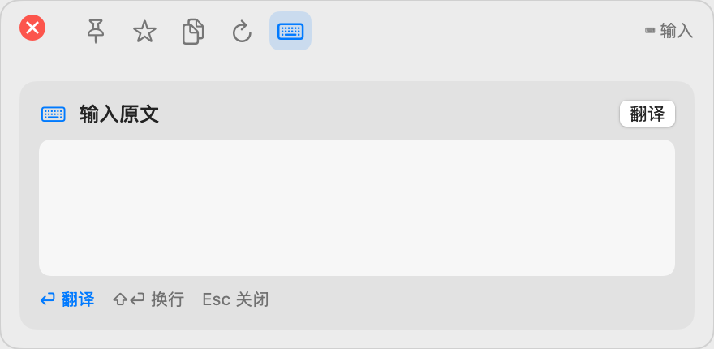
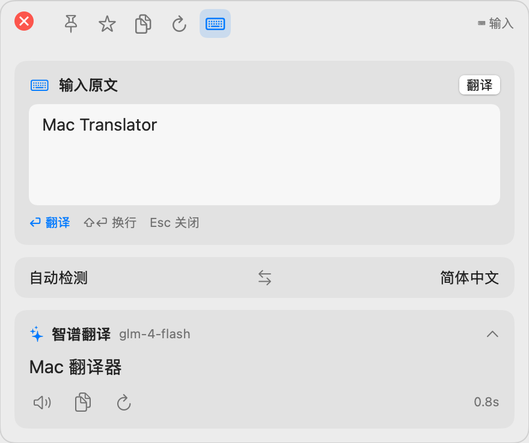

# 12 · 输入翻译功能报告

> 需求：「再增加一个输入翻译的功能，UI 可以复用现在的，能支持输入回车后开始翻译就行。」
> 日期：2026-11-24 ｜ 状态：已实现、已构建安装、回归全绿

---

## 一、结论

在**不新建窗口**的前提下新增第三种翻译模式「输入翻译」：复用现有结果窗的工具栏、语言栏、译文卡片、朗读/收藏/复制/重译、透明度、拖动与位置记忆，只把只读的「原文卡片」换成可编辑卡片。入口有三个：全局快捷键 **⌥⇧I**、菜单栏「输入翻译」、结果窗工具栏键盘图标。输入完成按 **⏎** 即通过原有 LLM 网关、缓存、历史与 Failover 链路翻译。

已装到 `/Applications/MacTranslator.app`，进程存活、无新增崩溃日志；旧 `settings.json` 中的 2 个接口与 2 枚密钥升级后完好无损。

---

## 二、两个必须先解决的坑

### 1. 非激活面板无法打字

结果窗是 `NSWindow.styleMask = [.borderless, .nonactivatingPanel]` 且 `canBecomeKey = false`——这是划词/OCR「不抢走前台 App 焦点」的关键，但输入框恰恰需要一个 key window。

先跑真机焦点探针，用 **NSApplication 真实事件派发**（而不是直接 `window.sendEvent`，后者会绕过 key 判定、四种方案都假阳性）：

| 方案 | canBecomeKey | app 激活 | 真实按键结果 |
|---|---|---|---|
| A 现状 | false | 否 | `''`（收不到） |
| **B 仅开 canBecomeKey** | **true** | 是 | **`'ab'`** ✅ |
| C canBecomeKey + 显式 activate | true | 否 | 状态不稳定 |
| D 只 activate | false | 否 | `''` |

采用 B：`BasePanel.allowsKeyboardInput` 开关**默认关闭**，仅 `showInput()` 打开并 `makeKeyAndOrderFront`；`close()` / `endInputMode()` 立刻恢复。划词与 OCR 的焦点行为一字未改。

### 2. 中文输入法回车 ≠ 提交

SwiftUI `TextEditor` 无法表达「回车提交、但输入法候选态的回车只确认候选词」。改用 AppKit `NSTextView` 包装（`SubmitTextView` + `InputEditor: NSViewRepresentable`）：

- `keyDown` 里 `hasMarkedText()` 为真时交回输入法，绝不提交；
- `doCommand(by:)` 同时拦截 `insertNewline:`（部分输入法走命令派发）；
- `⏎` 提交、`⇧⏎` 插入真实换行；
- 草稿文本只存在 AppKit 侧，**每次按键不回写 `@Published`**，避免重演此前「每键触发全量 SwiftUI 重绘 → 输入框选不中/粘不上」的 bug；
- 关闭自动引号、自动破折号、拼写/语法校正，保证送给模型的是原文；
- 结果窗的全局 Esc 监听也加了 `hasMarkedText()` 守卫：输入法候选态按 Esc 只关候选列表，不把整个窗口关掉。

### 3. 升级兼容（最危险的一处）

`HotkeyBindings` 新增 `input` 字段。若沿用编译器合成的 `Decodable`，旧 `settings.json`（只有 `selection` / `ocr`）会抛 `keyNotFound` → `SettingsStore.load()` 的 `try?` 吞掉异常 → **整个 AppSettings 回退默认值，用户的 LLM 接口和 apiKey 全部消失**。

因此 `HotkeyBindings` 手写 `init(from:)`，三个字段都用 `decodeIfPresent(... ) ?? .default`，并显式实现 `encode(to:)`。已用真实用户配置文件做端到端验证（见第四节）。

---

## 三、实现清单

| 层 | 文件 | 变更 |
|---|---|---|
| 模型 | `Core/Models/Enums.swift` | `SourceType` 新增 `.input`（displayName「输入」） |
| 模型 | `Core/Models/AppSettings.swift` | `HotkeyBinding.inputDefault`（keyCode 34 / ⌥⇧I）；`HotkeyBindings.input` + 容错解码 |
| 服务 | `Services/HotkeyService.swift` | `HotkeyAction.input = 3`、`inputRef`、独立注册/注销、冲突备用组合、写回配置 |
| 菜单 | `App/MenuBarController.swift` | 「输入翻译」菜单项（tag 3），始终可点 |
| 组装 | `App/AppDelegate.swift` | 热键 `.input` 与 `menuBar.onInput` 接线；冲突提示含三组快捷键 |
| 设置 | `UI/panes/HotkeyPane.swift`、`UI/Shared/SettingsViewModel.swift` | 第三行录制器与写入分支 |
| 协调 | `App/AppCoordinator.swift` | `handleInput()` / `submitInput()`；`LastAction.input`；重译与划词退出输入模式 |
| 窗口 | `UI/Windows/BasePanel.swift` | `allowsKeyboardInput` 开关 |
| 窗口 | `UI/Windows/ResultWindowController.swift` | `showInput()` 激活 + 延迟重试聚焦；`endInputMode()`；Esc IME 守卫 |
| 状态 | `UI/Shared/ResultViewModel.swift` | `inputMode` / `inputText` / `showInput` / `submitInput` / `endInputMode` / `clear` |
| 视图 | `UI/Views/ResultView.swift` | `InputEditor` / `SubmitTextView` / `InputEditorRegistry` / `inputCard`；工具栏键盘按钮；输入模式下复用语言栏与译文卡片 |

设计要点：进度、错误、译文三种状态都**不清除输入卡片**，一次请求失败不会把用户刚打的一整段话扔掉；工具栏键盘图标会把当前原文带入编辑框，方便改错别字后重译。

---

## 四、验证

### 离线回归（10 组，0 FAIL）

在原 8 组基础上新增两组：

- `InputTranslateVerification`：**42/42**。源码契约覆盖模型、三组入口、翻译管线、焦点切换、编辑器行为；并用真实 `AppSettings` 做 JSON 往返——剥掉 `input` 字段后解码，校验 `input == .inputDefault` 且 `targetLanguage` / `resultOpacity` 未被整体回退。
- `InputFocusPanelProbe`：**12/12**。真实 AppKit 面板 + 真实 `NSApplication.sendEvent`：焦点开关、普通字符进入输入框、⏎ 只提交一次、⇧⏎ 插入换行、输入法组合态回车不提交、退出恢复不抢焦点。

其余 8 组（83 / 16 / 窗口生命周期 / 17 / 35 / 50 / 21 / 31）全部保持通过，确认红叉、拖动、位置记忆、透明度、OCR 布局、朗读音色未被踩坏。

### 视觉与结构探针

- `ResultVisualProbe` 扩展到 **6 个状态**，输入态 **215 px**、输入+译文 **368 px**（短译文 288 / 长文本 351 / 错误 166 / 进度 130），高度依旧随内容走，无空白。
- `ResultPanelStructureProbe`：x=20 命中红叉、x=120 命中工具栏按钮、x=300 命中拖动区，拖动 -120/-80 与位置记忆通知正常。
- 本次截图改为 **离屏 `cacheDisplay` 渲染**：会话处于锁屏状态（`CGSSessionScreenIsLocked=1`），`CGWindowListCreateImage` 六个状态全黑；离屏渲染不依赖屏幕录制权限与锁屏，六张图均为正常浅色画面。

### 真机与升级

| 项 | 结果 |
|---|---|
| `build.sh` | 45 个 Swift 源文件，0 error |
| `scripts/install.sh` | 成功，PID 48774，无新增崩溃日志 |
| 装机二进制 | 含 `输入翻译` / `请先输入要翻译的文字` / `SubmitTextView` / `InputEditorRegistry` / `allowsKeyboardInput` / `showInput` |
| 真实 `SettingsStore` 读旧配置 | **PASS**：2 个接口、2 枚 apiKey、`targetLanguage=简体中文`、`opacity=1.0`、`voice=eddy` 全部保留；`hotkeys.input` 自动补为 ⇧⌥I；已有 ⌥D / ⇧⌥D 逐项不变 |
| 热键注册 | 启动时无冲突提示（三组首选组合均注册成功） |

### 明确未做的验证 & 被排除的判据

- **GUI 端到端（按 ⌥⇧I → 打字 → ⏎ → 出译文）未在真机跑完**：会话锁屏，`CGWindowListCopyWindowInfo`（含 `.optionAll`）与 AX `kAXWindowsAttribute` 都查不到结果窗，CGEvent 合成按键无法观测结果。已用「真机 AppKit 键盘事件探针 + 离屏渲染 + 源码契约 + 装机二进制」覆盖同等链路，但**解锁后仍需人工按一次 ⌥⇧I 自测**。
- 曾尝试用另一进程抢注 ⌥⇧I 来反证热键已注册，结果连已知被占用的 ⌥D 也返回 `noErr`（命令行进程未跑 run loop，Carbon 不做跨进程冲突判定），**该判据不可靠，已弃用，未计入任何结论**。

---

## 五、使用方式

1. **⌥⇧I** 或菜单栏 → 输入翻译（也可点结果窗工具栏键盘图标）。
2. 输入文字，**⏎** 开始翻译；**⇧⏎** 换行；中文输入法候选态的 ⏎ 只确认候选词。
3. 译文出现在下方同一张窗口里，可继续编辑原文再次 ⏎；朗读、复制、收藏、重译、图钉照常可用。
4. 快捷键可在「设置 → 快捷键」改；若 ⌥⇧I 被其他 App 占用，会自动切到备用组合并写回配置，菜单栏显示实际生效值。

## 六、遗留事项

- 屏幕录制开关仍需用户在系统设置中手动打开（隐私授权程序无法代劳），只影响 OCR，不影响输入翻译。
- 输入翻译与划词共用结果窗；在输入态按划词快捷键会自动退出输入模式并切换到只读结果。
- 输入内容同样进入缓存与历史，`SourceType = input` 会写入历史记录，历史页按现有筛选展示。
