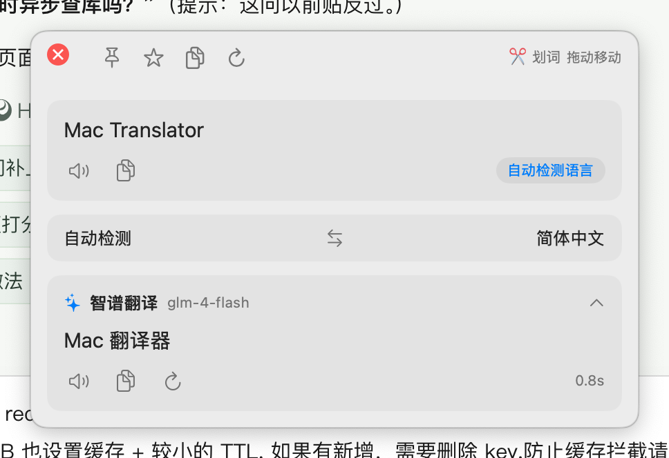
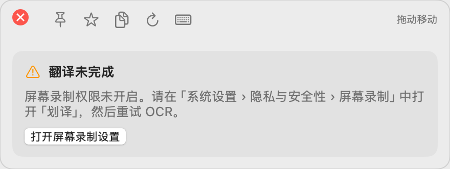

# 划译 · MacTranslator

> A macOS menu-bar translator: hotkey text translation and screenshot OCR, powered by any OpenAI-compatible LLM.

一个常驻菜单栏的 macOS 翻译工具。选中文字按快捷键即译，或框选屏幕任意区域做 OCR 翻译；翻译模型完全由你自己配置，支持多个 OpenAI 兼容接口按优先级自动故障切换。历史、收藏、缓存全部本地持久化——没有账号、没有订阅、没有第三方运行时依赖。



## 功能

| 能力 | 说明 |
| --- | --- |
| 划词翻译 | 全局快捷键取词，三级兜底：`AXUIElement` → 浏览器 AppleScript → `⌘C`，并完整恢复剪贴板快照 |
| 截图 OCR 翻译 | 框选区域 → ScreenCaptureKit 截图 → 本地 Vision 识别；也可切换为多模态 LLM 直接读图 |
| 多接口 Failover | 多个 OpenAI 兼容接口拖拽排序，每次只调一个；网络错误 / 20s 超时 / 非 2xx / 非法响应才切下一个，结果标注降级来源 |
| 结果窗 | 紧凑卡片式布局，高度随内容自适应；图钉固定、朗读、折叠、复制、收藏、重译、可调不透明度、拖动位置记忆 |
| 朗读音色 | 原文/译文一键朗读；「设置 → 通用」可选 10 种音色并中英文试听，默认中英同款 Eddy，系统特效音已排除 |
| 历史与收藏 | Core Data 本地存储，支持保留条数限制与检索 |
| 缓存 | 基于 `sha256(输入+语言+模型+类型)` 的 500 条 LRU，可开关与清除 |
| 离线可用部分 | 本地 Vision OCR 不需要联网；Ollama 等本地模型可作为翻译后端 |

## 快速开始

**要求**：macOS 13.0+，Apple Command Line Tools（**不需要安装 Xcode.app**），Swift 5.9+。全部使用系统框架。

```bash
git clone https://github.com/lengfengbyit/mac-translator.git
cd mac-translator/MacTranslator
chmod +x build.sh scripts/install.sh
./scripts/install.sh
```

`install.sh` 会：用 `swiftc` 一次编译 45 个 Swift 源文件 → 生成 Core Data `.momd` → 组装 `.app` bundle → 签名 → 备份旧版 → 安装到 `/Applications` → 启动。只构建不安装用 `./build.sh`，产物在 `build/MacTranslator.app`。

用 Xcode 的话直接 `open MacTranslator.xcodeproj`。

> Command Line Tools 不带 `momc` / `actool`，脚本内嵌了一个 Swift helper 解析 `Model.xcdatamodel/contents` 生成 `.momd`，并给实体的 `representedClassName` 补上 `MacTranslator.` 模块前缀。改动构建脚本时别把这两点踩回去。

## 首次配置

1. 菜单栏图标 → **设置 → LLM 接口**，添加 `baseURL` / `apiKey` / `model`，拖拽调整优先级；`baseURL` 指向 `/v1/chat/completions` 的上一级。
2. **系统设置 → 隐私与安全性**：打开「辅助功能」和「屏幕录制」。OCR 缺权限时结果窗会直接给出带跳转按钮的错误卡片。
3. 默认快捷键：**⌥D** 划词、**⌥⇧S** 截图 OCR。若与 Bob / iShot 等工具冲突，热键注册失败会自动切换到备用组合并写回配置，菜单栏也会显示实际生效的组合；也可在「设置 → 快捷键」自定义。



本地模型示例（Ollama）：`baseURL = http://localhost:11434/v1`，`model` 填本地模型名，`apiKey` 随意填。

```text
配置：~/Library/Application Support/mac_translator/settings.json   （权限 600）
历史：~/Library/Application Support/mac_translator/MacTranslator.sqlite
缓存：~/Library/Application Support/mac_translator/cache.json
```

## 权限

| 权限 | 用途 | 缺失影响 |
| --- | --- | --- |
| 辅助功能 | `AXUIElement` 读取选中文本、模拟 `⌘C` 兜底 | 划词仅剩浏览器 AppleScript 路径 |
| 屏幕录制 | 区域截图 OCR | OCR 不可用，结果窗提示引导授权 |
| 自动化 | 浏览器 AppleScript 取词 | 划词降级为 AX → `⌘C` |

权限状态用 `CGPreflightScreenCaptureAccess()` 精确查询（不是靠「截图黑不黑」猜）。签名方式变化或 App 被移动后需要重新授权，详见 `MacTranslator/README.md` 的签名章节。

## 工程结构

```text
MacTranslator/
├── Sources/MacTranslator/
│   ├── App/            入口、AppDelegate、Coordinator、菜单栏
│   ├── Core/           模型、协议、扩展
│   ├── Services/       热键、取词、截图、OCR、LLM 网关、缓存、配置、权限、持久化
│   ├── UI/             AppKit 窗口容器 + SwiftUI 视图 / 设置面板
│   └── Resources/      Info.plist、entitlements、Core Data 模型
├── Tests/
│   ├── MacTranslatorTests/        4 组 XCTest 单元测试
│   └── OfflineVerification/       6 组离线回归 + 视觉 / 端到端探针
├── scripts/           构建、安装、签名公证、DMG 打包
├── build.sh           无 Xcode 的一键 swiftc 构建
├── Package.swift
└── MacTranslator.xcodeproj/
```

根目录的 `01` ~ `10` 是完整交付文档（可行性、PRD、技术文档、各轮 QA / BugFix 报告），`03-产品原型.html` 是可交互的单文件产品原型。

## 验证

```bash
cd MacTranslator
zsh Tests/OfflineVerification/run.sh
```

8 组离线回归（持久化、窗口生命周期、输入框焦点、结果窗事件链、OCR 与布局、朗读音色源码断言、真实系统语音探针等）全部通过、0 失败；另有窗口结构命中测试、结果页浅/深色视觉探针、以及「坐标转换 → 截图 → Vision 识别」端到端探针。

## 安全与隐私

- `apiKey` 明文保存在本地 `settings.json`，文件权限 `600`。按设计**不使用系统钥匙串**，不会再弹钥匙串授权框；接口列表一律遮罩显示。
- 选中的文字与截图只发送给你自己配置的 LLM 接口；本地 Vision OCR 完全离线。
- `settings.json` / `cache.json` / `*.sqlite` 已被 `.gitignore` 排除，请勿手工提交。

## 已知限制

- 默认签名为 ad-hoc / 自签证书；公证与 Developer ID 分发需要 Apple Developer 账号。
- 多模态 OCR 只会调用勾选了 `supportsVision` 的接口，未配置视觉模型时会给出提示。
- ScreenCaptureKit 截图主路径要求 macOS 15.2+，更老系统回退到已标记 obsolete 的 `CGWindowListCreateImage`。
- 自动复制结果 / 系统通知 / 替换选中文本属于 P2 备选，尚未实现。

## 文档索引

| 文件 | 内容 |
| --- | --- |
| [01-可行性分析.md](01-可行性分析.md) | 技术 / 权限 / 竞品可行性结论 |
| [02-PRD.md](02-PRD.md) | P0/P1/P2 需求清单 |
| [03-产品原型.html](03-产品原型.html) | 可交互原型 |
| [04-技术文档.md](04-技术文档.md) | 架构设计 + 历轮实现变更记录 |
| [05-QA验证报告.md](05-QA验证报告.md) ~ [10-截图翻译与结果页修复报告.md](10-截图翻译与结果页修复报告.md) | 各轮 QA 与 BugFix 记录 |
| [11-朗读音色修复报告.md](11-朗读音色修复报告.md) | 英文朗读误选系统特效音的诊断与音色可配置化 |
| [MacTranslator/README.md](MacTranslator/README.md) | 工程级构建 / 签名 / 权限细节 |

## License

[MIT](LICENSE)
